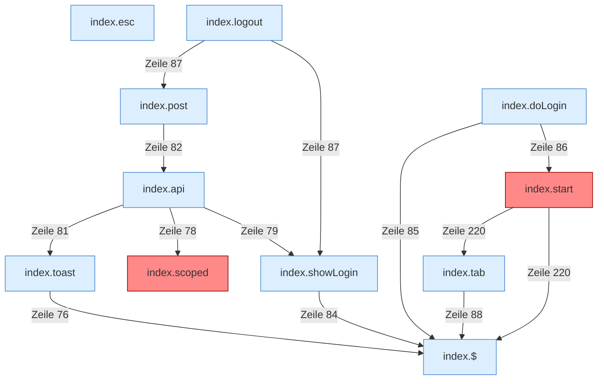

[[00 Start]] › [[Dashboard-UI]] › [[Legacy-Sitzung]]

# Legacy-Sitzung



```knoten
index.$
  Sucht auf der älteren [[Glossar#Bedienseite|Bedienseite]] ein einzelnes Element.
index.toast
  Zeigt in der älteren [[Glossar#Bedienseite|Bedienseite]] einen kurzen Hinweis.
index.scoped
  Gibt einen Dateipfad unverändert zurück. Der Name klingt nach einer Prüfung, es ist aber keine. Auffällig: ein alter Weg läuft noch mit. Das nennt man [[Glossar#Altlast|Altlast]].
index.api
  Schickt von der älteren [[Glossar#Bedienseite|Bedienseite]] eine Anfrage an die [[Glossar#Web-Schnittstelle|Web-Schnittstelle]].
index.post
  Schickt von der älteren [[Glossar#Bedienseite|Bedienseite]] einen Auftrag, der etwas ändert.
index.esc
  Macht einen Text so ungefährlich, dass die Seite ihn anzeigen kann.
index.showLogin
  Die ältere [[Glossar#Bedienseite|Bedienseite]] zeigt die [[Glossar#Anmeldung|Anmeldung]].
index.doLogin
  Die ältere [[Glossar#Bedienseite|Bedienseite]] führt aus die [[Glossar#Anmeldung|Anmeldung]].
index.logout
  Meldet von der älteren [[Glossar#Bedienseite|Bedienseite]] ab.
index.tab
  Wechselt in der älteren [[Glossar#Bedienseite|Bedienseite]] den sichtbaren Bereich.
index.start
  Die ältere [[Glossar#Bedienseite|Bedienseite]] fragt ab jetzt alle drei Sekunden nach dem Zustand. Auffällig: derselbe Teil ist zweimal vorhanden. Das nennt man [[Glossar#Doppelt gebaut|Doppelt gebaut]].
```

> [!knoten] Was die Blöcke tun
> - **index.$**: Sucht auf der älteren [[Glossar#Bedienseite|Bedienseite]] ein einzelnes Element.
> - **index.toast**: Zeigt in der älteren [[Glossar#Bedienseite|Bedienseite]] einen kurzen Hinweis.
> - **index.scoped**: Gibt einen Dateipfad unverändert zurück. Der Name klingt nach einer Prüfung, es ist aber keine. Auffällig: ein alter Weg läuft noch mit. Das nennt man [[Glossar#Altlast|Altlast]].
> - **index.api**: Schickt von der älteren [[Glossar#Bedienseite|Bedienseite]] eine Anfrage an die [[Glossar#Web-Schnittstelle|Web-Schnittstelle]].
> - **index.post**: Schickt von der älteren [[Glossar#Bedienseite|Bedienseite]] einen Auftrag, der etwas ändert.
> - **index.esc**: Macht einen Text so ungefährlich, dass die Seite ihn anzeigen kann.
> - **index.showLogin**: Die ältere [[Glossar#Bedienseite|Bedienseite]] zeigt die [[Glossar#Anmeldung|Anmeldung]].
> - **index.doLogin**: Die ältere [[Glossar#Bedienseite|Bedienseite]] führt aus die [[Glossar#Anmeldung|Anmeldung]].
> - **index.logout**: Meldet von der älteren [[Glossar#Bedienseite|Bedienseite]] ab.
> - **index.tab**: Wechselt in der älteren [[Glossar#Bedienseite|Bedienseite]] den sichtbaren Bereich.
> - **index.start**: Die ältere [[Glossar#Bedienseite|Bedienseite]] fragt ab jetzt alle drei Sekunden nach dem Zustand. Auffällig: derselbe Teil ist zweimal vorhanden. Das nennt man [[Glossar#Doppelt gebaut|Doppelt gebaut]].

- [[Glossar#Anmeldung|Anmeldung]] und Abmeldung in der älteren [[Glossar#Bedienseite|Bedienseite]].
