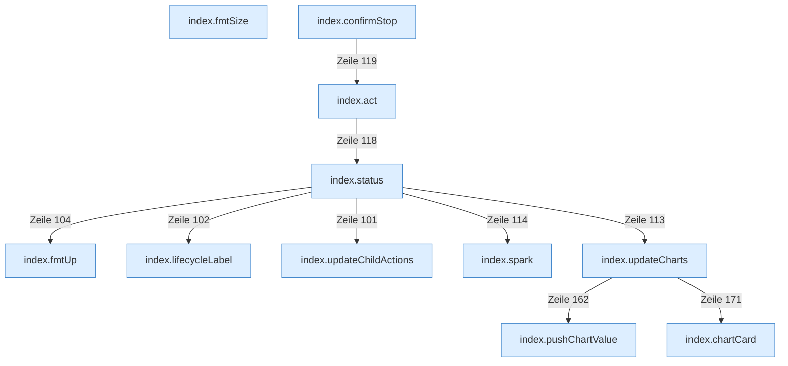

[[00 Start]] › [[Dashboard-UI]] › [[Legacy-Status]]

# Legacy-Status



```knoten
index.fmtUp
  Die ältere [[Glossar#Bedienseite|Bedienseite]] macht lesbar die Laufzeit.
index.fmtSize
  Die ältere [[Glossar#Bedienseite|Bedienseite]] macht lesbar die Größe.
index.lifecycleLabel
  Setzt die Beschriftung, die den Zustand in der älteren [[Glossar#Bedienseite|Bedienseite]] zeigt.
index.updateChildActions
  Die ältere [[Glossar#Bedienseite|Bedienseite]] ändert den [[Glossar#Spielserver|Spielserver]] die Tätigkeiten.
index.status
  Holt den Zustand und zeichnet ihn in die ältere [[Glossar#Bedienseite|Bedienseite]].
index.act
  Schickt von der älteren [[Glossar#Bedienseite|Bedienseite]] Start, [[Glossar#Stopp|Stopp]] oder [[Glossar#Neustart|Neustart]].
index.confirmStop
  Die ältere [[Glossar#Bedienseite|Bedienseite]] fragt nach den [[Glossar#Stopp|Stopp]].
index.spark
  Zeichnet in der älteren [[Glossar#Bedienseite|Bedienseite]] eine kleine Kurve der letzten Messwerte.
index.pushChartValue
  Die ältere [[Glossar#Bedienseite|Bedienseite]] zeichnet den Wert.
index.updateCharts
  Die ältere [[Glossar#Bedienseite|Bedienseite]] ändert die Kurven.
index.chartCard
  Baut in der älteren [[Glossar#Bedienseite|Bedienseite]] eine Karte mit einer Kurve.
```

> [!knoten] Was die Blöcke tun
> - **index.fmtUp**: Die ältere [[Glossar#Bedienseite|Bedienseite]] macht lesbar die Laufzeit.
> - **index.fmtSize**: Die ältere [[Glossar#Bedienseite|Bedienseite]] macht lesbar die Größe.
> - **index.lifecycleLabel**: Setzt die Beschriftung, die den Zustand in der älteren [[Glossar#Bedienseite|Bedienseite]] zeigt.
> - **index.updateChildActions**: Die ältere [[Glossar#Bedienseite|Bedienseite]] ändert den [[Glossar#Spielserver|Spielserver]] die Tätigkeiten.
> - **index.status**: Holt den Zustand und zeichnet ihn in die ältere [[Glossar#Bedienseite|Bedienseite]].
> - **index.act**: Schickt von der älteren [[Glossar#Bedienseite|Bedienseite]] Start, [[Glossar#Stopp|Stopp]] oder [[Glossar#Neustart|Neustart]].
> - **index.confirmStop**: Die ältere [[Glossar#Bedienseite|Bedienseite]] fragt nach den [[Glossar#Stopp|Stopp]].
> - **index.spark**: Zeichnet in der älteren [[Glossar#Bedienseite|Bedienseite]] eine kleine Kurve der letzten Messwerte.
> - **index.pushChartValue**: Die ältere [[Glossar#Bedienseite|Bedienseite]] zeichnet den Wert.
> - **index.updateCharts**: Die ältere [[Glossar#Bedienseite|Bedienseite]] ändert die Kurven.
> - **index.chartCard**: Baut in der älteren [[Glossar#Bedienseite|Bedienseite]] eine Karte mit einer Kurve.

- Die ältere [[Glossar#Bedienseite|Bedienseite]] fragt alle drei Sekunden nach, wie es dem [[Glossar#Spielserver|Spielserver]] geht.
