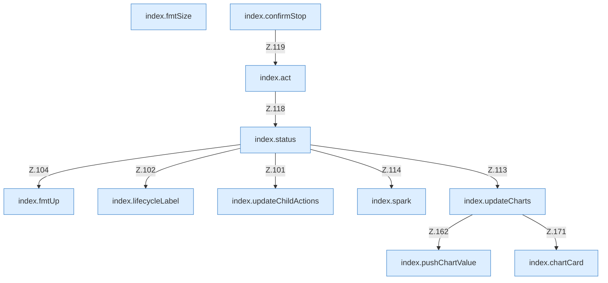

[[00 Start]] › [[Dashboard-UI]] › [[Legacy-Status]]

# Legacy-Status



```knoten
index.fmtUp
  Formatiert `fmtUp`.
index.fmtSize
  Formatiert `fmtSize`.
index.lifecycleLabel
  `lifecycleLabel` in `index.html`.
index.updateChildActions
  Aktualisiert `updateChildActions`. Ruft `$`.
index.status
  Liefert den Status `status`. Ruft `api`, `updateChildActions`, `$`.
index.act
  Sendet start, stop oder restart `act`. Ruft `$`, `post`, `toast`.
index.confirmStop
  Fragt nach `confirmStop`. Ruft `act`.
index.spark
  Zeichnet eine Sparkline `spark`.
index.pushChartValue
  Schiebt einen Wert in `pushChartValue`.
index.updateCharts
  Aktualisiert `updateCharts`. Ruft `pushChartValue`, `$`, `chartCard`.
index.chartCard
  Zeichnet das Diagramm `chartCard`. Ruft `x`, `y`.
```


