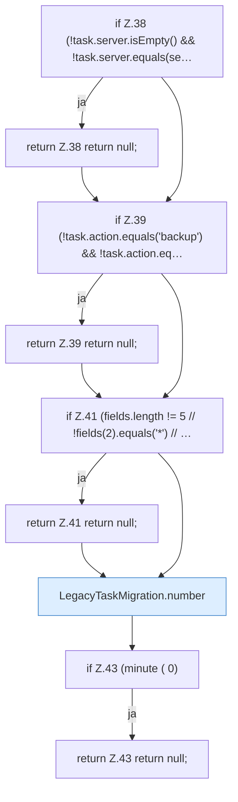

[[00 Start]] › [[Zeitplaene]] › [[Plan-Klassen]] › [[LegacyTaskMigration]] › [[LegacyTaskMigration.convert]] › [[LegacyTaskMigration.convert.Teil1]]

# LegacyTaskMigration.convert.Teil1



```knoten
if Z.38 (!task.server.isEmpty() && !task.server.equals(se…
  Zeile 38: prüft `(!task.server.isEmpty() && !task.server.equals(se…`.
return Z.38 return null;
  Zeile 38: Rückgabe `return null;`.
if Z.39 (!task.action.equals('backup') && !task.action.eq…
  Zeile 39: prüft `(!task.action.equals('backup') && !task.action.eq…`.
return Z.39 return null;
  Zeile 39: Rückgabe `return null;`.
if Z.41 (fields.length != 5 // !fields(2).equals('*') // …
  Zeile 41: prüft `(fields.length != 5 // !fields(2).equals('*') // …`.
return Z.41 return null;
  Zeile 41: Rückgabe `return null;`.
LegacyTaskMigration.number
  Dieser Teil macht hier einen einzelnen Schritt. Eine Ebene tiefer steht er genauer. `number` in `LegacyTaskMigration.java`.
if Z.43 (minute ( 0)
  Zeile 43: prüft `(minute ( 0)`.
return Z.43 return null;
  Zeile 43: Rückgabe `return null;`.
```

> [!knoten]- Was die Blöcke tun
> - **if Z.38 (!task.server.isEmpty() && !task.server.equals(se…**: Zeile 38: prüft `(!task.server.isEmpty() && !task.server.equals(se…`.
> - **return Z.38 return null;**: Zeile 38: Rückgabe `return null;`.
> - **if Z.39 (!task.action.equals('backup') && !task.action.eq…**: Zeile 39: prüft `(!task.action.equals('backup') && !task.action.eq…`.
> - **return Z.39 return null;**: Zeile 39: Rückgabe `return null;`.
> - **if Z.41 (fields.length != 5 // !fields(2).equals('*') // …**: Zeile 41: prüft `(fields.length != 5 // !fields(2).equals('*') // …`.
> - **return Z.41 return null;**: Zeile 41: Rückgabe `return null;`.
> - **LegacyTaskMigration.number**: Dieser Teil macht hier einen einzelnen Schritt. Eine Ebene tiefer steht er genauer. `number` in `LegacyTaskMigration.java`.
> - **if Z.43 (minute ( 0)**: Zeile 43: prüft `(minute ( 0)`.
> - **return Z.43 return null;**: Zeile 43: Rückgabe `return null;`.

- Ein weiterer Abschnitt derselben Übersicht.
- Fortsetzung von `LegacyTaskMigration.convert`.
