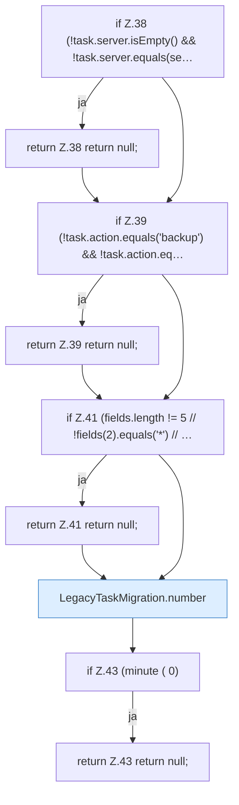

[[00 Start]] › [[Zeitplaene]] › [[Plan-Klassen]] › [[LegacyTaskMigration]] › [[LegacyTaskMigration.convert]] › [[LegacyTaskMigration.convert.Teil1]]

# LegacyTaskMigration.convert.Teil1

- Fortsetzung von `LegacyTaskMigration.convert`, Quellreihenfolge.
