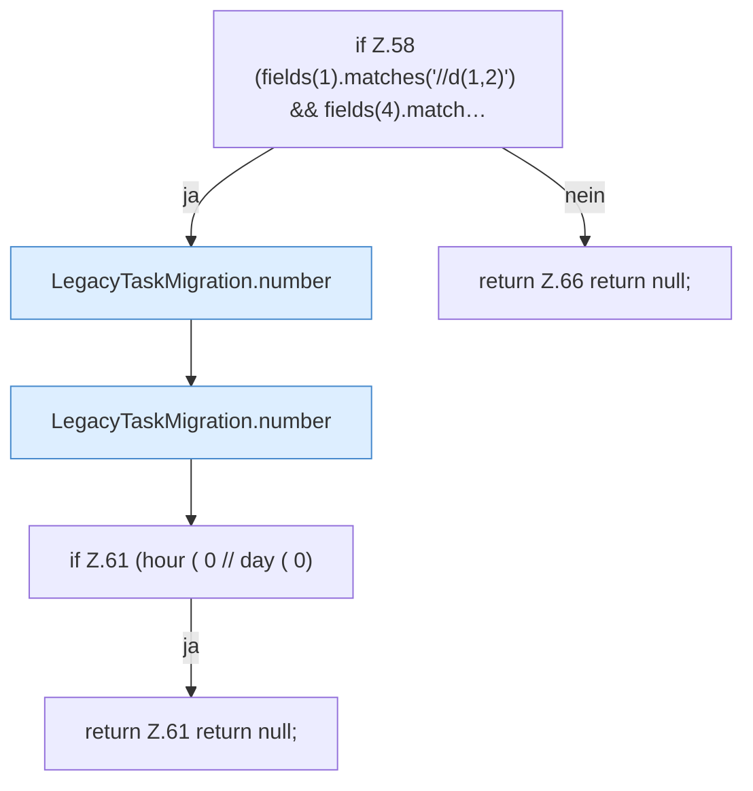

[[00 Start]] › [[Zeitplaene]] › [[Plan-Klassen]] › [[LegacyTaskMigration]] › [[LegacyTaskMigration.convert]] › [[LegacyTaskMigration.convert.Teil2.Z48.Z52.Z58]]

# LegacyTaskMigration.convert.Teil2.Z48.Z52.Z58



```knoten
if Z.58 (fields(1).matches('//d(1,2)') && fields(4).match…
  Zeile 58: prüft `(fields(1).matches('//d(1,2)') && fields(4).match…`.
LegacyTaskMigration.number
  `number` in `LegacyTaskMigration.java`.
if Z.61 (hour ( 0 // day ( 0)
  Zeile 61: prüft `(hour ( 0 // day ( 0)`.
return Z.61 return null;
  Zeile 61: Rückgabe `return null;`.
return Z.66 return null;
  Zeile 66: Rückgabe `return null;`.
```

- Fortsetzung von `LegacyTaskMigration.convert.Teil2.Z48.Z52`, Quellreihenfolge.
