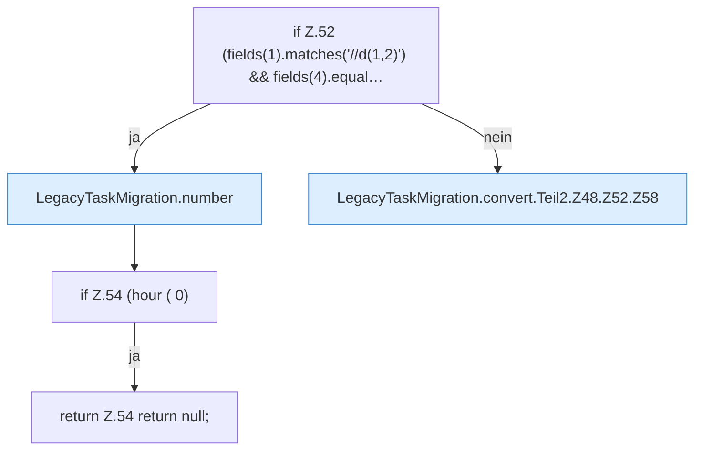

[[00 Start]] › [[Zeitplaene]] › [[Plan-Klassen]] › [[LegacyTaskMigration]] › [[LegacyTaskMigration.convert]] › [[LegacyTaskMigration.convert.Teil2.Z48.Z52]]

# LegacyTaskMigration.convert.Teil2.Z48.Z52

- Fortsetzung von `LegacyTaskMigration.convert.Teil2.Z48`, Quellreihenfolge.
