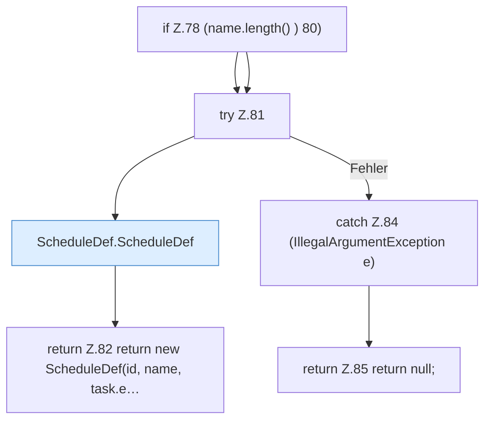

[[00 Start]] › [[Zeitplaene]] › [[Plan-Klassen]] › [[LegacyTaskMigration]] › [[LegacyTaskMigration.convert]] › [[LegacyTaskMigration.convert.Teil3]]

# LegacyTaskMigration.convert.Teil3



```knoten
if Z.78 (name.length() ) 80)
  Zeile 78: prüft `(name.length() ) 80)`.
try Z.81
  Zeile 81: Versuch. Der Fehlerpfad geht in catch.
ScheduleDef.ScheduleDef
  Der [[Glossar#Zeitplan|Zeitplan]] plant hier einen Schritt. Eine Ebene tiefer steht er genauer. Plant `ScheduleDef`. Ruft `validateInterval`.
return Z.82 return new ScheduleDef(id, name, task.e…
  Zeile 82: Rückgabe `return new ScheduleDef(id, name, task.e…`.
catch Z.84 (IllegalArgumentException e)
  Zeile 84: fängt (IllegalArgumentException e).
return Z.85 return null;
  Zeile 85: Rückgabe `return null;`.
```

> [!knoten]- Was die Blöcke tun
> - **if Z.78 (name.length() ) 80)**: Zeile 78: prüft `(name.length() ) 80)`.
> - **try Z.81**: Zeile 81: Versuch. Der Fehlerpfad geht in catch.
> - **ScheduleDef.ScheduleDef**: Der [[Glossar#Zeitplan|Zeitplan]] plant hier einen Schritt. Eine Ebene tiefer steht er genauer. Plant `ScheduleDef`. Ruft `validateInterval`.
> - **return Z.82 return new ScheduleDef(id, name, task.e…**: Zeile 82: Rückgabe `return new ScheduleDef(id, name, task.e…`.
> - **catch Z.84 (IllegalArgumentException e)**: Zeile 84: fängt (IllegalArgumentException e).
> - **return Z.85 return null;**: Zeile 85: Rückgabe `return null;`.

- Ein weiterer Abschnitt derselben Übersicht.
- Fortsetzung von `LegacyTaskMigration.convert`.
