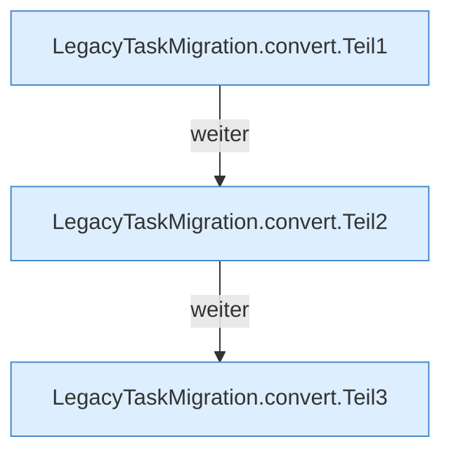

[[00 Start]] › [[Zeitplaene]] › [[Plan-Klassen]] › [[LegacyTaskMigration]] › [[LegacyTaskMigration.convert]]

# LegacyTaskMigration.convert

`LegacyTaskMigration.convert(TaskDef task, String selectedProfile, Set<String> ids)` [src/main/java/de/aichele/childlauncher/LegacyTaskMigration.java:37–87](https://github.com/Sciddie/minecraft-serverhoster-plugin/blob/95b02b953b0b4c23673e900e021a7c3c844aa37d/src/main/java/de/aichele/childlauncher/LegacyTaskMigration.java#L37-L87)

- `convert` in `src/main/java/de/aichele/childlauncher/LegacyTaskMigration.java`
