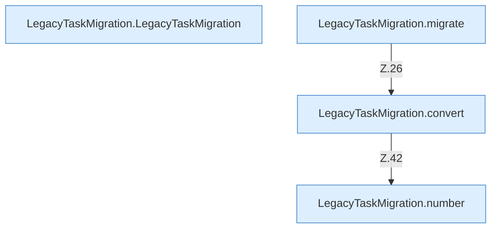

[[00 Start]] › [[Zeitplaene]] › [[Plan-Klassen]] › [[LegacyTaskMigration]]

# LegacyTaskMigration



```knoten
LegacyTaskMigration.LegacyTaskMigration
  Dieser Teil macht hier einen einzelnen Schritt. Eine Ebene tiefer steht er genauer. Im [[Glossar#Quelltext|Quelltext]] heißt das `LegacyTaskMigration`.
LegacyTaskMigration.migrate
  Dieser Teil übernimmt den alten Wert von das. Im [[Glossar#Quelltext|Quelltext]] heißt das `migrate`.
LegacyTaskMigration.convert
  Dieser Teil macht hier einen einzelnen Schritt. Eine Ebene tiefer steht er genauer. Im [[Glossar#Quelltext|Quelltext]] heißt das `convert`.
LegacyTaskMigration.number
  Dieser Teil macht hier einen einzelnen Schritt. Eine Ebene tiefer steht er genauer. Im [[Glossar#Quelltext|Quelltext]] heißt das `number`.
```

> [!knoten]- Was die Blöcke tun
> - **LegacyTaskMigration.LegacyTaskMigration**: Dieser Teil macht hier einen einzelnen Schritt. Eine Ebene tiefer steht er genauer. Im [[Glossar#Quelltext|Quelltext]] heißt das `LegacyTaskMigration`.
> - **LegacyTaskMigration.migrate**: Dieser Teil übernimmt den alten Wert von das. Im [[Glossar#Quelltext|Quelltext]] heißt das `migrate`.
> - **LegacyTaskMigration.convert**: Dieser Teil macht hier einen einzelnen Schritt. Eine Ebene tiefer steht er genauer. Im [[Glossar#Quelltext|Quelltext]] heißt das `convert`.
> - **LegacyTaskMigration.number**: Dieser Teil macht hier einen einzelnen Schritt. Eine Ebene tiefer steht er genauer. Im [[Glossar#Quelltext|Quelltext]] heißt das `number`.

- Übernimmt Einträge aus der älteren Aufgabenliste in die Zeitpläne.
