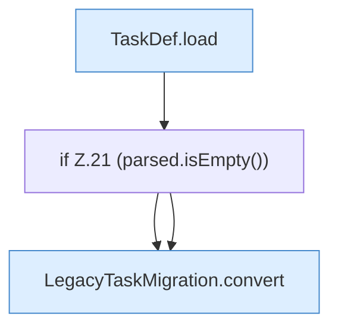

[[00 Start]] › [[Zeitplaene]] › [[Plan-Klassen]] › [[LegacyTaskMigration]] › [[LegacyTaskMigration.migrate]] › [[LegacyTaskMigration.migrate.Z19.Teil1]]

# LegacyTaskMigration.migrate.Z19.Teil1



```knoten
TaskDef.load
  Lädt `load`. Ruft `str`, `TaskDef`.
if Z.21 (parsed.isEmpty())
  Zeile 21: prüft `(parsed.isEmpty())`.
LegacyTaskMigration.convert
  Wandelt um `convert`. Ruft `number`, `ScheduleDef`.
```

- Fortsetzung von `LegacyTaskMigration.migrate.Z19`, Quellreihenfolge.
