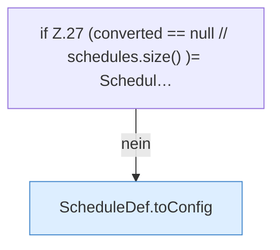

[[00 Start]] › [[Zeitplaene]] › [[Plan-Klassen]] › [[LegacyTaskMigration]] › [[LegacyTaskMigration.migrate]] › [[LegacyTaskMigration.migrate.Z19.Teil2]]

# LegacyTaskMigration.migrate.Z19.Teil2

- Fortsetzung von `LegacyTaskMigration.migrate.Z19`, Quellreihenfolge.
