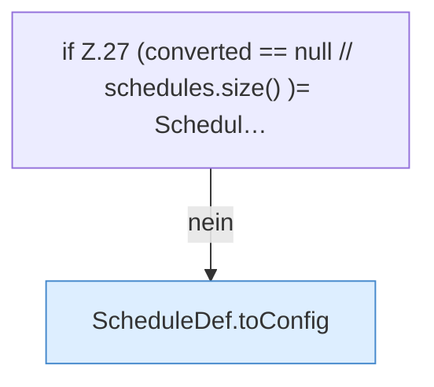

[[00 Start]] › [[Zeitplaene]] › [[Plan-Klassen]] › [[LegacyTaskMigration]] › [[LegacyTaskMigration.migrate]] › [[LegacyTaskMigration.migrate.Z19.Teil2]]

# LegacyTaskMigration.migrate.Z19.Teil2



```knoten
if Z.27 (converted == null // schedules.size() )= Schedul…
  Zeile 27: prüft `(converted == null // schedules.size() )= Schedul…`.
ScheduleDef.toConfig
  Der [[Glossar#Zeitplan|Zeitplan]] kümmert sich um die [[Glossar#Einstellungen|Einstellungen]]. `toConfig` in `ScheduleDef.java`. Ruft `toConfig`.
```

> [!knoten]- Was die Blöcke tun
> - **if Z.27 (converted == null // schedules.size() )= Schedul…**: Zeile 27: prüft `(converted == null // schedules.size() )= Schedul…`.
> - **ScheduleDef.toConfig**: Der [[Glossar#Zeitplan|Zeitplan]] kümmert sich um die [[Glossar#Einstellungen|Einstellungen]]. `toConfig` in `ScheduleDef.java`. Ruft `toConfig`.

- Ein weiterer Abschnitt derselben Übersicht.
- Fortsetzung von `LegacyTaskMigration.migrate.Z19`.
