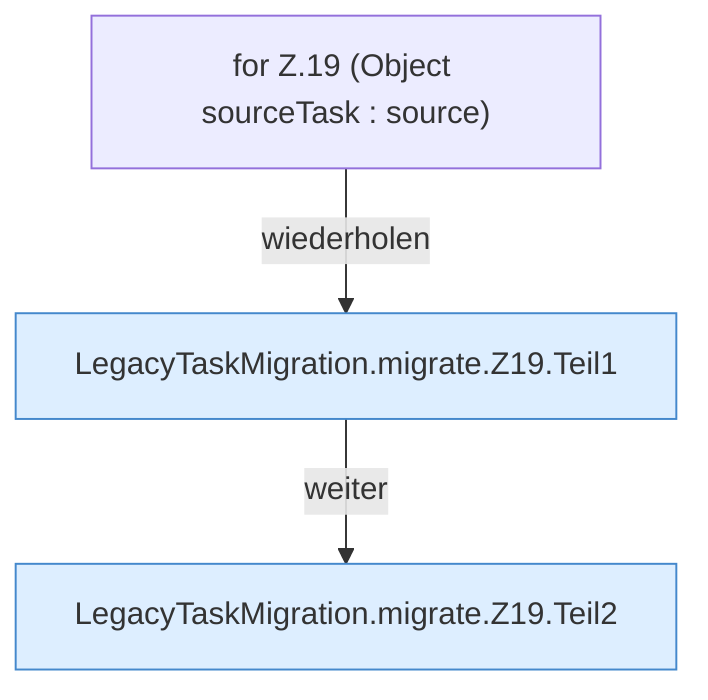

[[00 Start]] › [[Zeitplaene]] › [[Plan-Klassen]] › [[LegacyTaskMigration]] › [[LegacyTaskMigration.migrate]] › [[LegacyTaskMigration.migrate.Z19]]

# LegacyTaskMigration.migrate.Z19

- Fortsetzung von `LegacyTaskMigration.migrate`, Quellreihenfolge.
