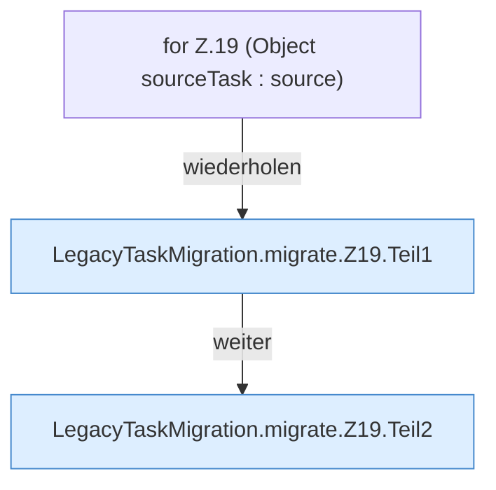

[[00 Start]] › [[Zeitplaene]] › [[Plan-Klassen]] › [[LegacyTaskMigration]] › [[LegacyTaskMigration.migrate]] › [[LegacyTaskMigration.migrate.Z19]]

# LegacyTaskMigration.migrate.Z19



```knoten
for Z.19 (Object sourceTask : source)
  Zeile 19: Schleife `(Object sourceTask : source)`.
LegacyTaskMigration.migrate.Z19.Teil1
  Ein weiterer Abschnitt derselben Übersicht. Abschnitt 1 dieses Ablaufs, in Quellreihenfolge.
LegacyTaskMigration.migrate.Z19.Teil2
  Ein weiterer Abschnitt derselben Übersicht. Abschnitt 2 dieses Ablaufs, in Quellreihenfolge.
```

> [!knoten]- Was die Blöcke tun
> - **for Z.19 (Object sourceTask : source)**: Zeile 19: Schleife `(Object sourceTask : source)`.
> - **LegacyTaskMigration.migrate.Z19.Teil1**: Ein weiterer Abschnitt derselben Übersicht. Abschnitt 1 dieses Ablaufs, in Quellreihenfolge.
> - **LegacyTaskMigration.migrate.Z19.Teil2**: Ein weiterer Abschnitt derselben Übersicht. Abschnitt 2 dieses Ablaufs, in Quellreihenfolge.

- Der Ablauf geht in [[Glossar#Zeile|Zeile]] 19 weiter. Eine Ebene tiefer steht er genauer.
- Fortsetzung von `LegacyTaskMigration.migrate`.
