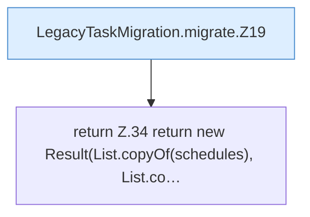

[[00 Start]] › [[Zeitplaene]] › [[Plan-Klassen]] › [[LegacyTaskMigration]] › [[LegacyTaskMigration.migrate]]

# LegacyTaskMigration.migrate

`LegacyTaskMigration.migrate(Object rawTasks, String selectedProfile, Set<String> usedScheduleIds)` [src/main/java/de/aichele/childlauncher/LegacyTaskMigration.java:14–35](https://github.com/Sciddie/minecraft-serverhoster-plugin/blob/95b02b953b0b4c23673e900e021a7c3c844aa37d/src/main/java/de/aichele/childlauncher/LegacyTaskMigration.java#L14-L35)



```knoten
LegacyTaskMigration.migrate.Z19
  Fortsetzung des Ablaufs ab Zeile 19.
return Z.34 return new Result(List.copyOf(schedules), List.co…
  Zeile 34: Rückgabe `return new Result(List.copyOf(schedules), List.co…`.
```

- `migrate` in `src/main/java/de/aichele/childlauncher/LegacyTaskMigration.java`
