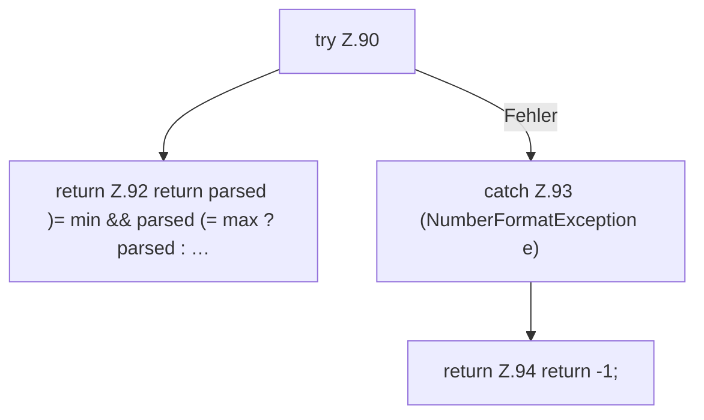

[[00 Start]] › [[Zeitplaene]] › [[Plan-Klassen]] › [[LegacyTaskMigration]] › [[LegacyTaskMigration.number]]

# LegacyTaskMigration.number

`LegacyTaskMigration.number(String value, int min, int max)` [src/main/java/de/aichele/childlauncher/LegacyTaskMigration.java:89–96](https://github.com/Sciddie/minecraft-serverhoster-plugin/blob/95b02b953b0b4c23673e900e021a7c3c844aa37d/src/main/java/de/aichele/childlauncher/LegacyTaskMigration.java#L89-L96)



```knoten
try Z.90
  Zeile 90: Versuch. Der Fehlerpfad geht in catch.
return Z.92 return parsed )= min && parsed (= max ? parsed : …
  Zeile 92: Rückgabe `return parsed )= min && parsed (= max ? parsed : …`.
catch Z.93 (NumberFormatException e)
  Zeile 93: fängt (NumberFormatException e).
return Z.94 return -1;
  Zeile 94: Rückgabe `return -1;`.
```

- `number` in `src/main/java/de/aichele/childlauncher/LegacyTaskMigration.java`
