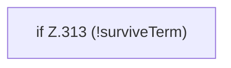

[[00 Start]] › [[Tests]] › [[LifecycleRobustnessTest]] › [[LifecycleRobustnessTest.Teil3]] › [[LifecycleRobustnessTest.FakeProcesses.destroy]]

# LifecycleRobustnessTest.FakeProcesses.destroy

`LifecycleRobustnessTest.FakeProcesses.destroy(long pid)` [src/test/java/de/aichele/childlauncher/LifecycleRobustnessTest.java:311–314](https://github.com/Sciddie/minecraft-serverhoster-plugin/blob/95b02b953b0b4c23673e900e021a7c3c844aa37d/src/test/java/de/aichele/childlauncher/LifecycleRobustnessTest.java#L311-L314)



```knoten
if Z.313 (!surviveTerm)
  Zeile 313: prüft `(!surviveTerm)`.
```

- `destroy` in `src/test/java/de/aichele/childlauncher/LifecycleRobustnessTest.java`
- Auslöser: Test
