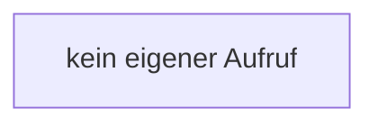

[[00 Start]] › [[Tests]] › [[LifecycleRobustnessTest]] › [[LifecycleRobustnessTest.Teil3]] › [[LifecycleRobustnessTest.FakeProcesses.destroyForcibly]]

# LifecycleRobustnessTest.FakeProcesses.destroyForcibly

`LifecycleRobustnessTest.FakeProcesses.destroyForcibly(long pid)` [src/test/java/de/aichele/childlauncher/LifecycleRobustnessTest.java:315–318](https://github.com/Sciddie/minecraft-serverhoster-plugin/blob/95b02b953b0b4c23673e900e021a7c3c844aa37d/src/test/java/de/aichele/childlauncher/LifecycleRobustnessTest.java#L315-L318)



```knoten
kein eigener Aufruf
  In diesem Stück gibt es keinen weiteren eigenen Aufruf.
```

- `destroyForcibly` in `src/test/java/de/aichele/childlauncher/LifecycleRobustnessTest.java`
- Auslöser: Test
