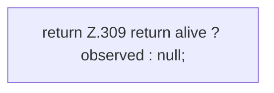

[[00 Start]] › [[Tests]] › [[LifecycleRobustnessTest]] › [[LifecycleRobustnessTest.Teil3]] › [[LifecycleRobustnessTest.FakeProcesses.find]]

# LifecycleRobustnessTest.FakeProcesses.find

`LifecycleRobustnessTest.FakeProcesses.find(long pid)` [src/test/java/de/aichele/childlauncher/LifecycleRobustnessTest.java:308–310](https://github.com/Sciddie/minecraft-serverhoster-plugin/blob/95b02b953b0b4c23673e900e021a7c3c844aa37d/src/test/java/de/aichele/childlauncher/LifecycleRobustnessTest.java#L308-L310)



```knoten
return Z.309 return alive ? observed : null;
  Zeile 309: Rückgabe `return alive ? observed : null;`.
```

> [!knoten]- Was die Blöcke tun
> - **return Z.309 return alive ? observed : null;**: Zeile 309: Rückgabe `return alive ? observed : null;`.

- Ein Schritt in einem [[Glossar#Probelauf|Probelauf]]. Er gehört nicht zum laufenden Server.
- `find` in `src/test/java/de/aichele/childlauncher/LifecycleRobustnessTest.java`
- Das ist ein Probelauf, kein Teil des laufenden Servers.
