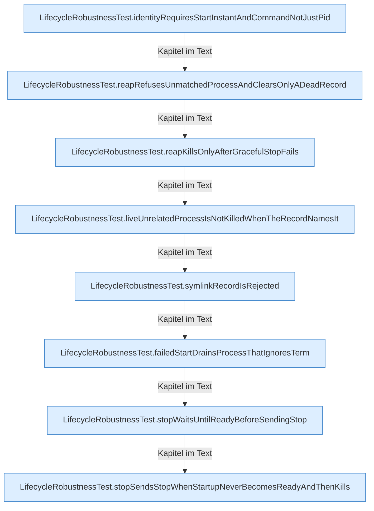

[[00 Start]] › [[Tests]] › [[LifecycleRobustnessTest]] › [[LifecycleRobustnessTest.Teil1]]

# LifecycleRobustnessTest.Teil1



```knoten
LifecycleRobustnessTest.identityRequiresStartInstantAndCommandNotJustPid
  Ein Schritt in einem [[Glossar#Probelauf|Probelauf]]. Er gehört nicht zum laufenden Server. Im [[Glossar#Quelltext|Quelltext]] heißt das `identityRequiresStartInstantAndCommandNotJustPid`.
LifecycleRobustnessTest.reapRefusesUnmatchedProcessAndClearsOnlyADeadRecord
  Ein Schritt in einem [[Glossar#Probelauf|Probelauf]]. Er gehört nicht zum laufenden Server. Im [[Glossar#Quelltext|Quelltext]] heißt das `reapRefusesUnmatchedProcessAndClearsOnlyADeadRecord`.
LifecycleRobustnessTest.reapKillsOnlyAfterGracefulStopFails
  Ein Schritt in einem [[Glossar#Probelauf|Probelauf]]. Er gehört nicht zum laufenden Server. Im [[Glossar#Quelltext|Quelltext]] heißt das `reapKillsOnlyAfterGracefulStopFails`.
LifecycleRobustnessTest.liveUnrelatedProcessIsNotKilledWhenTheRecordNamesIt
  Ein Schritt in einem [[Glossar#Probelauf|Probelauf]]. Er gehört nicht zum laufenden Server. Im [[Glossar#Quelltext|Quelltext]] heißt das `liveUnrelatedProcessIsNotKilledWhenTheRecordNamesIt`.
LifecycleRobustnessTest.symlinkRecordIsRejected
  Ein Schritt in einem [[Glossar#Probelauf|Probelauf]]. Er gehört nicht zum laufenden Server. Im [[Glossar#Quelltext|Quelltext]] heißt das `symlinkRecordIsRejected`.
LifecycleRobustnessTest.failedStartDrainsProcessThatIgnoresTerm
  Ein Schritt in einem [[Glossar#Probelauf|Probelauf]]. Er gehört nicht zum laufenden Server. Im [[Glossar#Quelltext|Quelltext]] heißt das `failedStartDrainsProcessThatIgnoresTerm`.
LifecycleRobustnessTest.stopWaitsUntilReadyBeforeSendingStop
  Ein Schritt in einem [[Glossar#Probelauf|Probelauf]]. Er gehört nicht zum laufenden Server. Im [[Glossar#Quelltext|Quelltext]] heißt das `stopWaitsUntilReadyBeforeSendingStop`.
LifecycleRobustnessTest.stopSendsStopWhenStartupNeverBecomesReadyAndThenKills
  Ein Schritt in einem [[Glossar#Probelauf|Probelauf]]. Er gehört nicht zum laufenden Server. Im [[Glossar#Quelltext|Quelltext]] heißt das `stopSendsStopWhenStartupNeverBecomesReadyAndThenKills`.
```

> [!knoten]- Was die Blöcke tun
> - **LifecycleRobustnessTest.identityRequiresStartInstantAndCommandNotJustPid**: Ein Schritt in einem [[Glossar#Probelauf|Probelauf]]. Er gehört nicht zum laufenden Server. Im [[Glossar#Quelltext|Quelltext]] heißt das `identityRequiresStartInstantAndCommandNotJustPid`.
> - **LifecycleRobustnessTest.reapRefusesUnmatchedProcessAndClearsOnlyADeadRecord**: Ein Schritt in einem [[Glossar#Probelauf|Probelauf]]. Er gehört nicht zum laufenden Server. Im [[Glossar#Quelltext|Quelltext]] heißt das `reapRefusesUnmatchedProcessAndClearsOnlyADeadRecord`.
> - **LifecycleRobustnessTest.reapKillsOnlyAfterGracefulStopFails**: Ein Schritt in einem [[Glossar#Probelauf|Probelauf]]. Er gehört nicht zum laufenden Server. Im [[Glossar#Quelltext|Quelltext]] heißt das `reapKillsOnlyAfterGracefulStopFails`.
> - **LifecycleRobustnessTest.liveUnrelatedProcessIsNotKilledWhenTheRecordNamesIt**: Ein Schritt in einem [[Glossar#Probelauf|Probelauf]]. Er gehört nicht zum laufenden Server. Im [[Glossar#Quelltext|Quelltext]] heißt das `liveUnrelatedProcessIsNotKilledWhenTheRecordNamesIt`.
> - **LifecycleRobustnessTest.symlinkRecordIsRejected**: Ein Schritt in einem [[Glossar#Probelauf|Probelauf]]. Er gehört nicht zum laufenden Server. Im [[Glossar#Quelltext|Quelltext]] heißt das `symlinkRecordIsRejected`.
> - **LifecycleRobustnessTest.failedStartDrainsProcessThatIgnoresTerm**: Ein Schritt in einem [[Glossar#Probelauf|Probelauf]]. Er gehört nicht zum laufenden Server. Im [[Glossar#Quelltext|Quelltext]] heißt das `failedStartDrainsProcessThatIgnoresTerm`.
> - **LifecycleRobustnessTest.stopWaitsUntilReadyBeforeSendingStop**: Ein Schritt in einem [[Glossar#Probelauf|Probelauf]]. Er gehört nicht zum laufenden Server. Im [[Glossar#Quelltext|Quelltext]] heißt das `stopWaitsUntilReadyBeforeSendingStop`.
> - **LifecycleRobustnessTest.stopSendsStopWhenStartupNeverBecomesReadyAndThenKills**: Ein Schritt in einem [[Glossar#Probelauf|Probelauf]]. Er gehört nicht zum laufenden Server. Im [[Glossar#Quelltext|Quelltext]] heißt das `stopSendsStopWhenStartupNeverBecomesReadyAndThenKills`.

- Ein weiterer Abschnitt derselben Übersicht.
