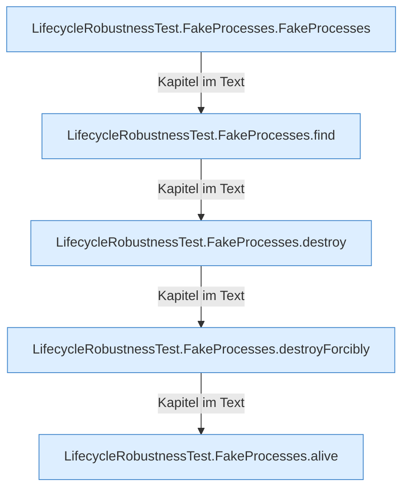

[[00 Start]] › [[Tests]] › [[LifecycleRobustnessTest]] › [[LifecycleRobustnessTest.Teil3]]

# LifecycleRobustnessTest.Teil3



```knoten
LifecycleRobustnessTest.FakeProcesses.FakeProcesses
  Ein Schritt in einem [[Glossar#Probelauf|Probelauf]]. Er gehört nicht zum laufenden Server. Im [[Glossar#Quelltext|Quelltext]] heißt das `FakeProcesses`.
LifecycleRobustnessTest.FakeProcesses.find
  Ein Schritt in einem [[Glossar#Probelauf|Probelauf]]. Er gehört nicht zum laufenden Server. Im [[Glossar#Quelltext|Quelltext]] heißt das `find`.
LifecycleRobustnessTest.FakeProcesses.destroy
  Ein Schritt in einem [[Glossar#Probelauf|Probelauf]]. Er gehört nicht zum laufenden Server. Im [[Glossar#Quelltext|Quelltext]] heißt das `destroy`.
LifecycleRobustnessTest.FakeProcesses.destroyForcibly
  Ein Schritt in einem [[Glossar#Probelauf|Probelauf]]. Er gehört nicht zum laufenden Server. Im [[Glossar#Quelltext|Quelltext]] heißt das `destroyForcibly`.
LifecycleRobustnessTest.FakeProcesses.alive
  Ein Schritt in einem [[Glossar#Probelauf|Probelauf]]. Er gehört nicht zum laufenden Server. Im [[Glossar#Quelltext|Quelltext]] heißt das `alive`.
```

> [!knoten]- Was die Blöcke tun
> - **LifecycleRobustnessTest.FakeProcesses.FakeProcesses**: Ein Schritt in einem [[Glossar#Probelauf|Probelauf]]. Er gehört nicht zum laufenden Server. Im [[Glossar#Quelltext|Quelltext]] heißt das `FakeProcesses`.
> - **LifecycleRobustnessTest.FakeProcesses.find**: Ein Schritt in einem [[Glossar#Probelauf|Probelauf]]. Er gehört nicht zum laufenden Server. Im [[Glossar#Quelltext|Quelltext]] heißt das `find`.
> - **LifecycleRobustnessTest.FakeProcesses.destroy**: Ein Schritt in einem [[Glossar#Probelauf|Probelauf]]. Er gehört nicht zum laufenden Server. Im [[Glossar#Quelltext|Quelltext]] heißt das `destroy`.
> - **LifecycleRobustnessTest.FakeProcesses.destroyForcibly**: Ein Schritt in einem [[Glossar#Probelauf|Probelauf]]. Er gehört nicht zum laufenden Server. Im [[Glossar#Quelltext|Quelltext]] heißt das `destroyForcibly`.
> - **LifecycleRobustnessTest.FakeProcesses.alive**: Ein Schritt in einem [[Glossar#Probelauf|Probelauf]]. Er gehört nicht zum laufenden Server. Im [[Glossar#Quelltext|Quelltext]] heißt das `alive`.

- Ein weiterer Abschnitt derselben Übersicht.
