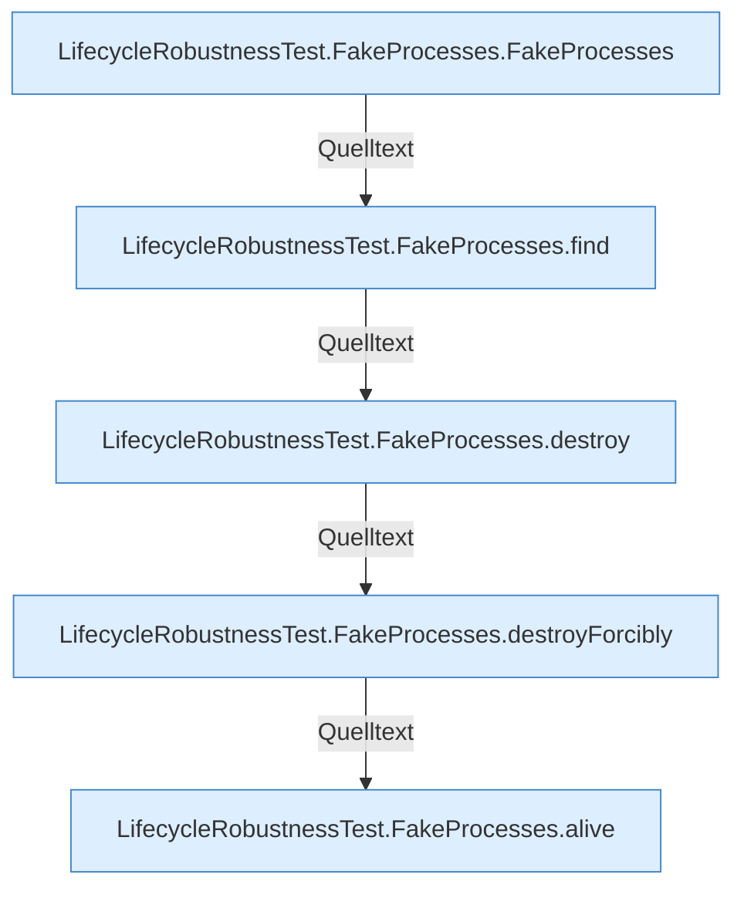

[[00 Start]] › [[Tests]] › [[LifecycleRobustnessTest]] › [[LifecycleRobustnessTest.Teil3]]

# LifecycleRobustnessTest.Teil3



```knoten
LifecycleRobustnessTest.FakeProcesses.FakeProcesses
  `FakeProcesses` in `LifecycleRobustnessTest.java`. Nur Test.
LifecycleRobustnessTest.FakeProcesses.find
  Sucht `find`. Nur Test.
LifecycleRobustnessTest.FakeProcesses.destroy
  Zerstört `destroy`. Nur Test.
LifecycleRobustnessTest.FakeProcesses.destroyForcibly
  Zerstört `destroyForcibly`. Nur Test.
LifecycleRobustnessTest.FakeProcesses.alive
  Sagt, ob der Prozess lebt `alive`. Nur Test.
```


