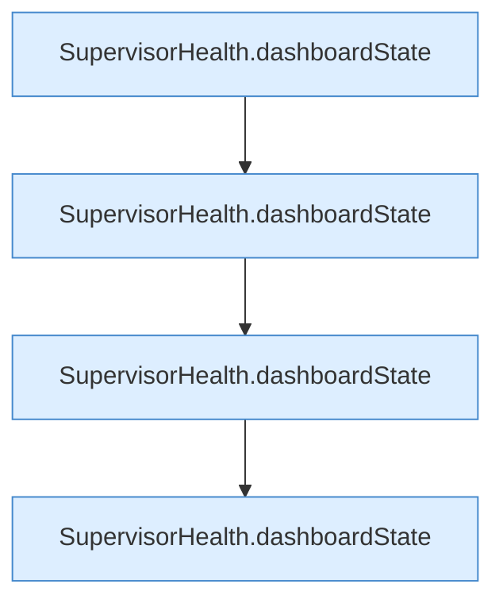

[[00 Start]] › [[Tests]] › [[LifecycleRobustnessTest]] › [[LifecycleRobustnessTest.Teil2]] › [[LifecycleRobustnessTest.dashboardDistinguishesLifecycleAndRestartCancellation]] › [[LifecycleRobustnessTest.dashboardDistinguishesLifecycleAndRestartCancellation.Teil2]]

# LifecycleRobustnessTest.dashboardDistinguishesLifecycleAndRestartCancellation.Teil2



```knoten
SupervisorHealth.dashboardState
  Dieser Teil kümmert sich um den Zustand. `dashboardState` in `SupervisorHealth.java`.
```

> [!knoten]- Was die Blöcke tun
> - **SupervisorHealth.dashboardState**: Dieser Teil kümmert sich um den Zustand. `dashboardState` in `SupervisorHealth.java`.

- Ein weiterer Abschnitt derselben Übersicht.
- Fortsetzung von `LifecycleRobustnessTest.dashboardDistinguishesLifecycleAndRestartCancellation`.
