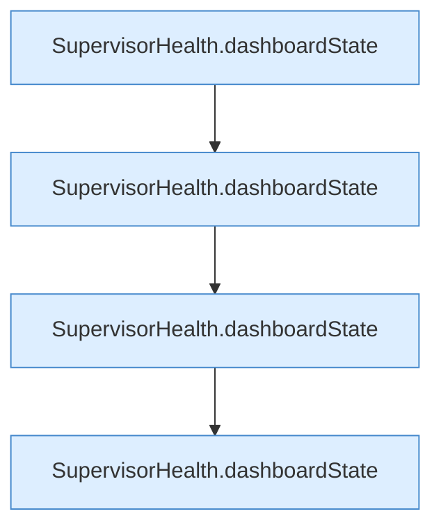

[[00 Start]] › [[Tests]] › [[LifecycleRobustnessTest]] › [[LifecycleRobustnessTest.Teil2]] › [[LifecycleRobustnessTest.dashboardDistinguishesLifecycleAndRestartCancellation]] › [[LifecycleRobustnessTest.dashboardDistinguishesLifecycleAndRestartCancellation.Teil2]]

# LifecycleRobustnessTest.dashboardDistinguishesLifecycleAndRestartCancellation.Teil2

- Fortsetzung von `LifecycleRobustnessTest.dashboardDistinguishesLifecycleAndRestartCancellation`, Quellreihenfolge.
