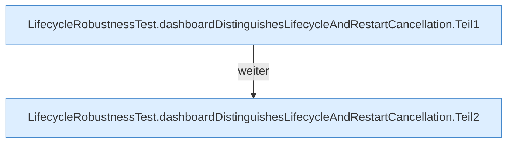

[[00 Start]] › [[Tests]] › [[LifecycleRobustnessTest]] › [[LifecycleRobustnessTest.Teil2]] › [[LifecycleRobustnessTest.dashboardDistinguishesLifecycleAndRestartCancellation]]

# LifecycleRobustnessTest.dashboardDistinguishesLifecycleAndRestartCancellation

`LifecycleRobustnessTest.dashboardDistinguishesLifecycleAndRestartCancellation()` [src/test/java/de/aichele/childlauncher/LifecycleRobustnessTest.java:192–205](https://github.com/Sciddie/minecraft-serverhoster-plugin/blob/95b02b953b0b4c23673e900e021a7c3c844aa37d/src/test/java/de/aichele/childlauncher/LifecycleRobustnessTest.java#L192-L205)

- `dashboardDistinguishesLifecycleAndRestartCancellation` in `src/test/java/de/aichele/childlauncher/LifecycleRobustnessTest.java`
- Auslöser: Test
