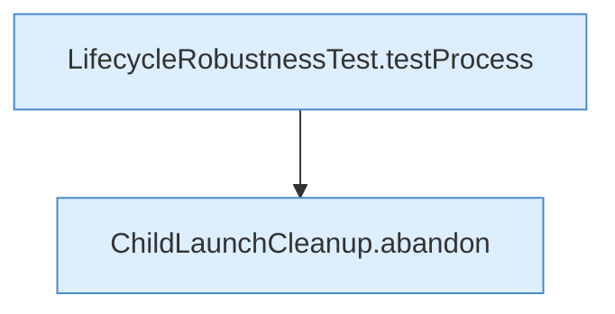

[[00 Start]] › [[Tests]] › [[LifecycleRobustnessTest]] › [[LifecycleRobustnessTest.Teil1]] › [[LifecycleRobustnessTest.failedStartDrainsProcessThatIgnoresTerm]]

# LifecycleRobustnessTest.failedStartDrainsProcessThatIgnoresTerm

`LifecycleRobustnessTest.failedStartDrainsProcessThatIgnoresTerm()` [src/test/java/de/aichele/childlauncher/LifecycleRobustnessTest.java:122–129](https://github.com/Sciddie/minecraft-serverhoster-plugin/blob/95b02b953b0b4c23673e900e021a7c3c844aa37d/src/test/java/de/aichele/childlauncher/LifecycleRobustnessTest.java#L122-L129)



```knoten
LifecycleRobustnessTest.testProcess
  Ein Schritt in einem [[Glossar#Probelauf|Probelauf]]. Er gehört nicht zum laufenden Server. Prüft `testProcess`. Nur Test.
ChildLaunchCleanup.abandon
  Dieser Teil bricht ab das. Bricht den fehlgeschlagenen Start ab `abandon`.
```

> [!knoten]- Was die Blöcke tun
> - **LifecycleRobustnessTest.testProcess**: Ein Schritt in einem [[Glossar#Probelauf|Probelauf]]. Er gehört nicht zum laufenden Server. Prüft `testProcess`. Nur Test.
> - **ChildLaunchCleanup.abandon**: Dieser Teil bricht ab das. Bricht den fehlgeschlagenen Start ab `abandon`.

- Ein Schritt in einem [[Glossar#Probelauf|Probelauf]]. Er gehört nicht zum laufenden Server.
- `failedStartDrainsProcessThatIgnoresTerm` in `src/test/java/de/aichele/childlauncher/LifecycleRobustnessTest.java`
- Das ist ein Probelauf, kein Teil des laufenden Servers.
