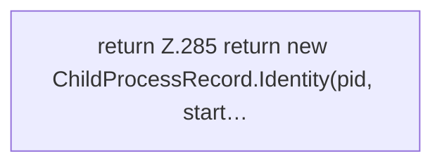

[[00 Start]] › [[Tests]] › [[LifecycleRobustnessTest]] › [[LifecycleRobustnessTest.Teil2]] › [[LifecycleRobustnessTest.identity]]

# LifecycleRobustnessTest.identity

`LifecycleRobustnessTest.identity(long pid, Instant start, String workDir, String jar)` [src/test/java/de/aichele/childlauncher/LifecycleRobustnessTest.java:284–286](https://github.com/Sciddie/minecraft-serverhoster-plugin/blob/95b02b953b0b4c23673e900e021a7c3c844aa37d/src/test/java/de/aichele/childlauncher/LifecycleRobustnessTest.java#L284-L286)



```knoten
return Z.285 return new ChildProcessRecord.Identity(pid, start…
  Zeile 285: Rückgabe `return new ChildProcessRecord.Identity(pid, start…`.
```

> [!knoten]- Was die Blöcke tun
> - **return Z.285 return new ChildProcessRecord.Identity(pid, start…**: Zeile 285: Rückgabe `return new ChildProcessRecord.Identity(pid, start…`.

- Ein Schritt in einem [[Glossar#Probelauf|Probelauf]]. Er gehört nicht zum laufenden Server.
- `identity` in `src/test/java/de/aichele/childlauncher/LifecycleRobustnessTest.java`
- Das ist ein Probelauf, kein Teil des laufenden Servers.
