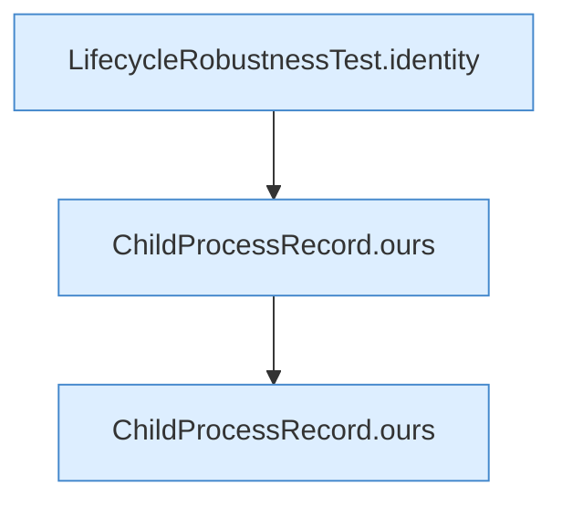

[[00 Start]] › [[Tests]] › [[LifecycleRobustnessTest]] › [[LifecycleRobustnessTest.Teil1]] › [[LifecycleRobustnessTest.identityRequiresStartInstantAndCommandNotJustPid]] › [[LifecycleRobustnessTest.identityRequiresStartInstantAndCommandNotJustPid.Teil1]]

# LifecycleRobustnessTest.identityRequiresStartInstantAndCommandNotJustPid.Teil1

- Fortsetzung von `LifecycleRobustnessTest.identityRequiresStartInstantAndCommandNotJustPid`, Quellreihenfolge.
