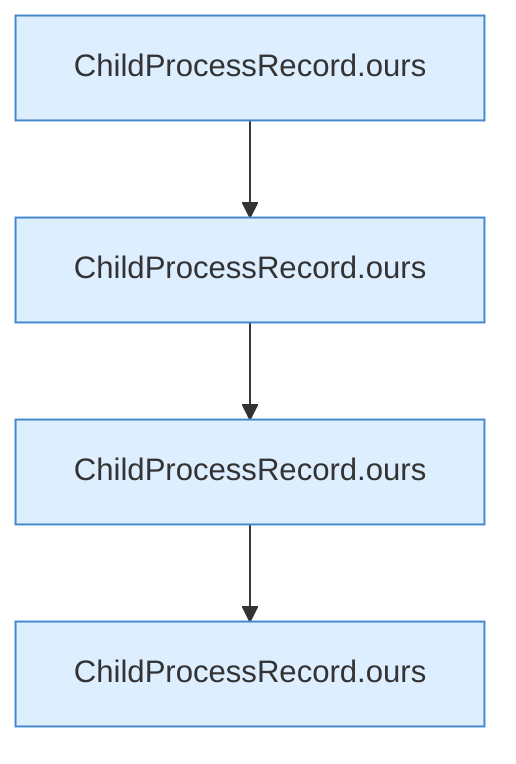

[[00 Start]] › [[Tests]] › [[LifecycleRobustnessTest]] › [[LifecycleRobustnessTest.Teil1]] › [[LifecycleRobustnessTest.identityRequiresStartInstantAndCommandNotJustPid]] › [[LifecycleRobustnessTest.identityRequiresStartInstantAndCommandNotJustPid.Teil2]]

# LifecycleRobustnessTest.identityRequiresStartInstantAndCommandNotJustPid.Teil2



```knoten
ChildProcessRecord.ours
  Prüft, ob es der eigene Prozess ist `ours`. Ruft `samePath`, `looksLikeJava`, `fileName`.
```

- Fortsetzung von `LifecycleRobustnessTest.identityRequiresStartInstantAndCommandNotJustPid`, Quellreihenfolge.
