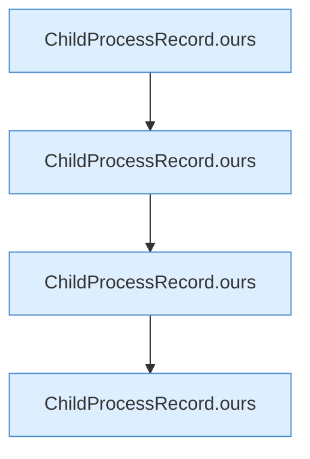

[[00 Start]] › [[Tests]] › [[LifecycleRobustnessTest]] › [[LifecycleRobustnessTest.Teil1]] › [[LifecycleRobustnessTest.identityRequiresStartInstantAndCommandNotJustPid]] › [[LifecycleRobustnessTest.identityRequiresStartInstantAndCommandNotJustPid.Teil2]]

# LifecycleRobustnessTest.identityRequiresStartInstantAndCommandNotJustPid.Teil2



```knoten
ChildProcessRecord.ours
  Dieser Teil macht hier einen einzelnen Schritt. Eine Ebene tiefer steht er genauer. Prüft, ob es der eigene [[Glossar#Prozess|Prozess]] ist `ours`. Ruft `samePath`, `looksLikeJava`, `fileName`.
```

> [!knoten]- Was die Blöcke tun
> - **ChildProcessRecord.ours**: Dieser Teil macht hier einen einzelnen Schritt. Eine Ebene tiefer steht er genauer. Prüft, ob es der eigene [[Glossar#Prozess|Prozess]] ist `ours`. Ruft `samePath`, `looksLikeJava`, `fileName`.

- Ein weiterer Abschnitt derselben Übersicht.
- Fortsetzung von `LifecycleRobustnessTest.identityRequiresStartInstantAndCommandNotJustPid`.
