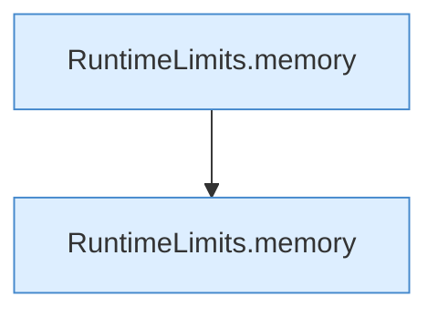

[[00 Start]] › [[Tests]] › [[LifecycleRobustnessTest]] › [[LifecycleRobustnessTest.Teil2]] › [[LifecycleRobustnessTest.invalidMemoryThresholdDisablesAutoStopWithoutRewritingHeap]] › [[LifecycleRobustnessTest.invalidMemoryThresholdDisablesAutoStopWithoutRewritingHeap.Teil1]]

# LifecycleRobustnessTest.invalidMemoryThresholdDisablesAutoStopWithoutRewritingHeap.Teil1



```knoten
RuntimeLimits.memory
  Dieser Teil macht hier einen einzelnen Schritt. Eine Ebene tiefer steht er genauer. Betrifft den Speicher `memory`. Ruft `percent`.
```

> [!knoten]- Was die Blöcke tun
> - **RuntimeLimits.memory**: Dieser Teil macht hier einen einzelnen Schritt. Eine Ebene tiefer steht er genauer. Betrifft den Speicher `memory`. Ruft `percent`.

- Ein weiterer Abschnitt derselben Übersicht.
- Fortsetzung von `LifecycleRobustnessTest.invalidMemoryThresholdDisablesAutoStopWithoutRewritingHeap`.
