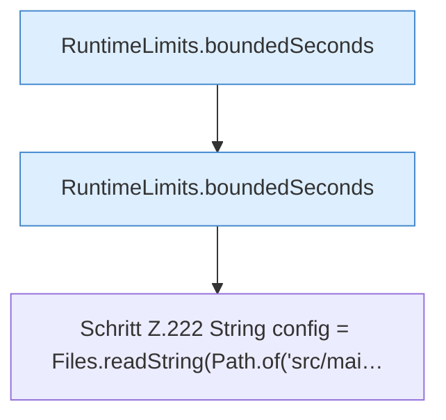

[[00 Start]] › [[Tests]] › [[LifecycleRobustnessTest]] › [[LifecycleRobustnessTest.Teil2]] › [[LifecycleRobustnessTest.invalidMemoryThresholdDisablesAutoStopWithoutRewritingHeap]] › [[LifecycleRobustnessTest.invalidMemoryThresholdDisablesAutoStopWithoutRewritingHeap.Teil2]]

# LifecycleRobustnessTest.invalidMemoryThresholdDisablesAutoStopWithoutRewritingHeap.Teil2



```knoten
RuntimeLimits.boundedSeconds
  Dieser Teil macht hier einen einzelnen Schritt. Eine Ebene tiefer steht er genauer. Begrenzt `boundedSeconds`.
Schritt Z.222 String config = Files.readString(Path.of('src/mai…
  Zeile 222: liest Text aus einer Datei. `String config = Files.readString(Path.of('src/mai…`
```

> [!knoten]- Was die Blöcke tun
> - **RuntimeLimits.boundedSeconds**: Dieser Teil macht hier einen einzelnen Schritt. Eine Ebene tiefer steht er genauer. Begrenzt `boundedSeconds`.
> - **Schritt Z.222 String config = Files.readString(Path.of('src/mai…**: Zeile 222: liest Text aus einer Datei. `String config = Files.readString(Path.of('src/mai…`

- Ein weiterer Abschnitt derselben Übersicht.
- Fortsetzung von `LifecycleRobustnessTest.invalidMemoryThresholdDisablesAutoStopWithoutRewritingHeap`.
