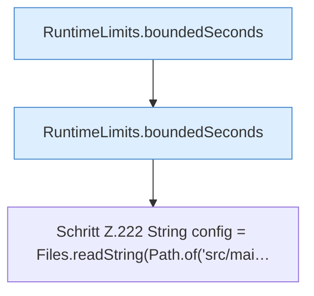

[[00 Start]] › [[Tests]] › [[LifecycleRobustnessTest]] › [[LifecycleRobustnessTest.Teil2]] › [[LifecycleRobustnessTest.invalidMemoryThresholdDisablesAutoStopWithoutRewritingHeap]] › [[LifecycleRobustnessTest.invalidMemoryThresholdDisablesAutoStopWithoutRewritingHeap.Teil2]]

# LifecycleRobustnessTest.invalidMemoryThresholdDisablesAutoStopWithoutRewritingHeap.Teil2

- Fortsetzung von `LifecycleRobustnessTest.invalidMemoryThresholdDisablesAutoStopWithoutRewritingHeap`, Quellreihenfolge.
