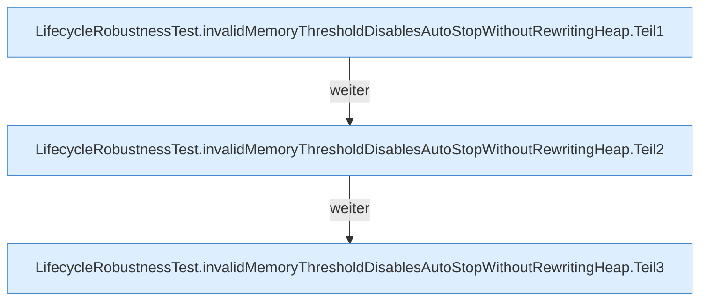

[[00 Start]] › [[Tests]] › [[LifecycleRobustnessTest]] › [[LifecycleRobustnessTest.Teil2]] › [[LifecycleRobustnessTest.invalidMemoryThresholdDisablesAutoStopWithoutRewritingHeap]]

# LifecycleRobustnessTest.invalidMemoryThresholdDisablesAutoStopWithoutRewritingHeap

`LifecycleRobustnessTest.invalidMemoryThresholdDisablesAutoStopWithoutRewritingHeap()` [src/test/java/de/aichele/childlauncher/LifecycleRobustnessTest.java:207–231](https://github.com/Sciddie/minecraft-serverhoster-plugin/blob/95b02b953b0b4c23673e900e021a7c3c844aa37d/src/test/java/de/aichele/childlauncher/LifecycleRobustnessTest.java#L207-L231)

- `invalidMemoryThresholdDisablesAutoStopWithoutRewritingHeap` in `src/test/java/de/aichele/childlauncher/LifecycleRobustnessTest.java`
- Auslöser: Test
