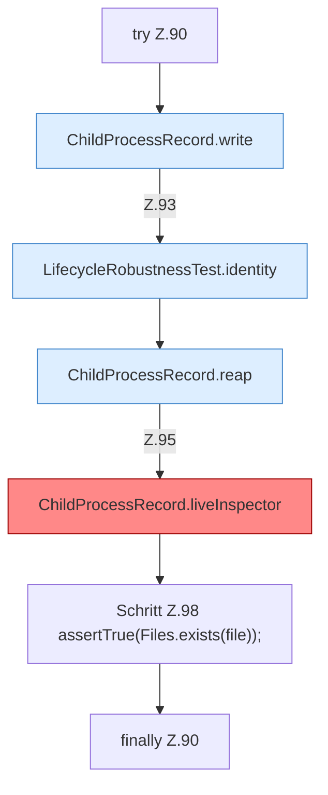

[[00 Start]] › [[Tests]] › [[LifecycleRobustnessTest]] › [[LifecycleRobustnessTest.Teil1]] › [[LifecycleRobustnessTest.liveUnrelatedProcessIsNotKilledWhenTheRecordNamesIt]] › [[LifecycleRobustnessTest.liveUnrelatedProcessIsNotKilledWhenTheRecordNamesIt.Z90]]

# LifecycleRobustnessTest.liveUnrelatedProcessIsNotKilledWhenTheRecordNamesIt.Z90

- Fortsetzung von `LifecycleRobustnessTest.liveUnrelatedProcessIsNotKilledWhenTheRecordNamesIt`, Quellreihenfolge.
