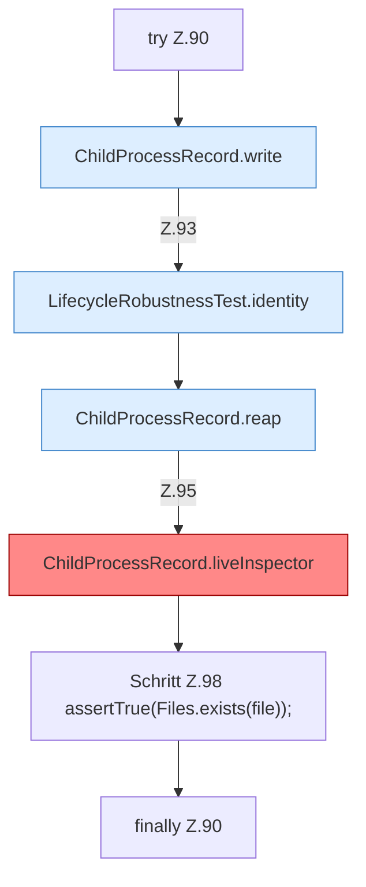

[[00 Start]] › [[Tests]] › [[LifecycleRobustnessTest]] › [[LifecycleRobustnessTest.Teil1]] › [[LifecycleRobustnessTest.liveUnrelatedProcessIsNotKilledWhenTheRecordNamesIt]] › [[LifecycleRobustnessTest.liveUnrelatedProcessIsNotKilledWhenTheRecordNamesIt.Z90]]

# LifecycleRobustnessTest.liveUnrelatedProcessIsNotKilledWhenTheRecordNamesIt.Z90



```knoten
try Z.90
  Zeile 90: Versuch. Der Fehlerpfad geht in catch.
ChildProcessRecord.write
  Dieser Teil schreibt das. Schreibt `write`. Ruft `safe`.
LifecycleRobustnessTest.identity
  Ein Schritt in einem [[Glossar#Probelauf|Probelauf]]. Er gehört nicht zum laufenden Server. `identity` in `LifecycleRobustnessTest.java`. Nur Test.
ChildProcessRecord.reap
  Dieser Teil räumt weg das. Räumt übrige [[Glossar#Prozess|Prozesse]] ab `reap`. Ruft `read`, `ours`, `waitUntilDead`.
ChildProcessRecord.liveInspector
  Dieser Teil macht hier einen einzelnen Schritt. Eine Ebene tiefer steht er genauer. `liveInspector` in `ChildProcessRecord.java`. Ruft `find`, `destroy`, `destroyForcibly`. [[Glossar#Befund|Befund]]: toter Code, wahrscheinlich. src/main/java/de/aichele/childlauncher/ChildProcessRecord.java:44–59 nur von Tests erreicht
Schritt Z.98 assertTrue(Files.exists(file));
  Zeile 98: Dateioperation. `assertTrue(Files.exists(file));`
finally Z.90
  Läuft danach immer, auch nach einem Fehler.
```

> [!knoten]- Was die Blöcke tun
> - **try Z.90**: Zeile 90: Versuch. Der Fehlerpfad geht in catch.
> - **ChildProcessRecord.write**: Dieser Teil schreibt das. Schreibt `write`. Ruft `safe`.
> - **LifecycleRobustnessTest.identity**: Ein Schritt in einem [[Glossar#Probelauf|Probelauf]]. Er gehört nicht zum laufenden Server. `identity` in `LifecycleRobustnessTest.java`. Nur Test.
> - **ChildProcessRecord.reap**: Dieser Teil räumt weg das. Räumt übrige [[Glossar#Prozess|Prozesse]] ab `reap`. Ruft `read`, `ours`, `waitUntilDead`.
> - **ChildProcessRecord.liveInspector**: Dieser Teil macht hier einen einzelnen Schritt. Eine Ebene tiefer steht er genauer. `liveInspector` in `ChildProcessRecord.java`. Ruft `find`, `destroy`, `destroyForcibly`. [[Glossar#Befund|Befund]]: toter Code, wahrscheinlich. src/main/java/de/aichele/childlauncher/ChildProcessRecord.java:44–59 nur von Tests erreicht
> - **Schritt Z.98 assertTrue(Files.exists(file));**: Zeile 98: Dateioperation. `assertTrue(Files.exists(file));`
> - **finally Z.90**: Läuft danach immer, auch nach einem Fehler.

- Der Ablauf geht in [[Glossar#Zeile|Zeile]] 90 weiter. Eine Ebene tiefer steht er genauer.
- Fortsetzung von `LifecycleRobustnessTest.liveUnrelatedProcessIsNotKilledWhenTheRecordNamesIt`.
