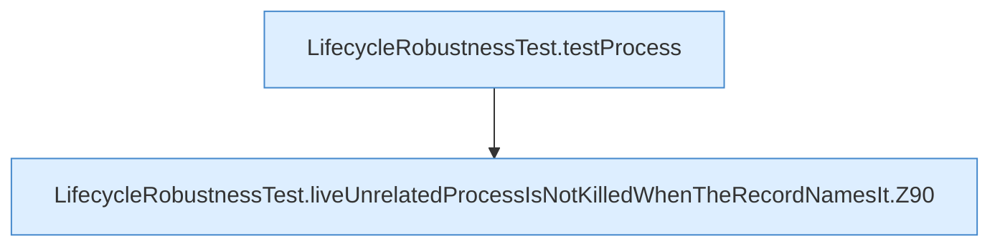

[[00 Start]] › [[Tests]] › [[LifecycleRobustnessTest]] › [[LifecycleRobustnessTest.Teil1]] › [[LifecycleRobustnessTest.liveUnrelatedProcessIsNotKilledWhenTheRecordNamesIt]]

# LifecycleRobustnessTest.liveUnrelatedProcessIsNotKilledWhenTheRecordNamesIt

`LifecycleRobustnessTest.liveUnrelatedProcessIsNotKilledWhenTheRecordNamesIt()` [src/test/java/de/aichele/childlauncher/LifecycleRobustnessTest.java:88–102](https://github.com/Sciddie/minecraft-serverhoster-plugin/blob/95b02b953b0b4c23673e900e021a7c3c844aa37d/src/test/java/de/aichele/childlauncher/LifecycleRobustnessTest.java#L88-L102)



```knoten
LifecycleRobustnessTest.testProcess
  Ein Schritt in einem [[Glossar#Probelauf|Probelauf]]. Er gehört nicht zum laufenden Server. Prüft `testProcess`. Nur Test.
LifecycleRobustnessTest.liveUnrelatedProcessIsNotKilledWhenTheRecordNamesIt.Z90
  Der Ablauf geht in [[Glossar#Zeile|Zeile]] 90 weiter. Eine Ebene tiefer steht er genauer. Fortsetzung des Ablaufs ab Zeile 90.
```

> [!knoten]- Was die Blöcke tun
> - **LifecycleRobustnessTest.testProcess**: Ein Schritt in einem [[Glossar#Probelauf|Probelauf]]. Er gehört nicht zum laufenden Server. Prüft `testProcess`. Nur Test.
> - **LifecycleRobustnessTest.liveUnrelatedProcessIsNotKilledWhenTheRecordNamesIt.Z90**: Der Ablauf geht in [[Glossar#Zeile|Zeile]] 90 weiter. Eine Ebene tiefer steht er genauer. Fortsetzung des Ablaufs ab Zeile 90.

- Ein Schritt in einem [[Glossar#Probelauf|Probelauf]]. Er gehört nicht zum laufenden Server.
- `liveUnrelatedProcessIsNotKilledWhenTheRecordNamesIt` in `src/test/java/de/aichele/childlauncher/LifecycleRobustnessTest.java`
- Das ist ein Probelauf, kein Teil des laufenden Servers.
