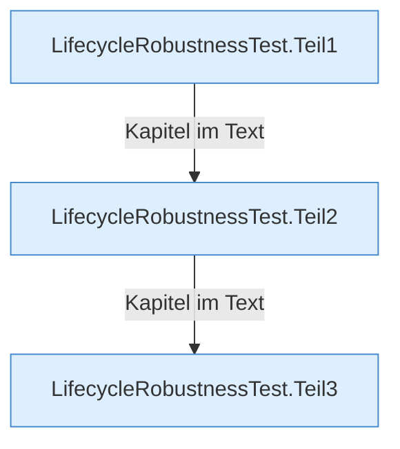

[[00 Start]] › [[Tests]] › [[LifecycleRobustnessTest]]

# LifecycleRobustnessTest



```knoten
LifecycleRobustnessTest.Teil1
  Ein weiterer Abschnitt derselben Übersicht.
LifecycleRobustnessTest.Teil2
  Ein weiterer Abschnitt derselben Übersicht.
LifecycleRobustnessTest.Teil3
  Ein weiterer Abschnitt derselben Übersicht.
```

> [!knoten] Was die Blöcke tun
> - **LifecycleRobustnessTest.Teil1**: Ein weiterer Abschnitt derselben Übersicht.
> - **LifecycleRobustnessTest.Teil2**: Ein weiterer Abschnitt derselben Übersicht.
> - **LifecycleRobustnessTest.Teil3**: Ein weiterer Abschnitt derselben Übersicht.

- [[Glossar#Probelauf|Probelauf]] für [[Glossar#Stopp|Stopp]], [[Glossar#Neustart|Neustart]] und einen Start, der scheitert.
