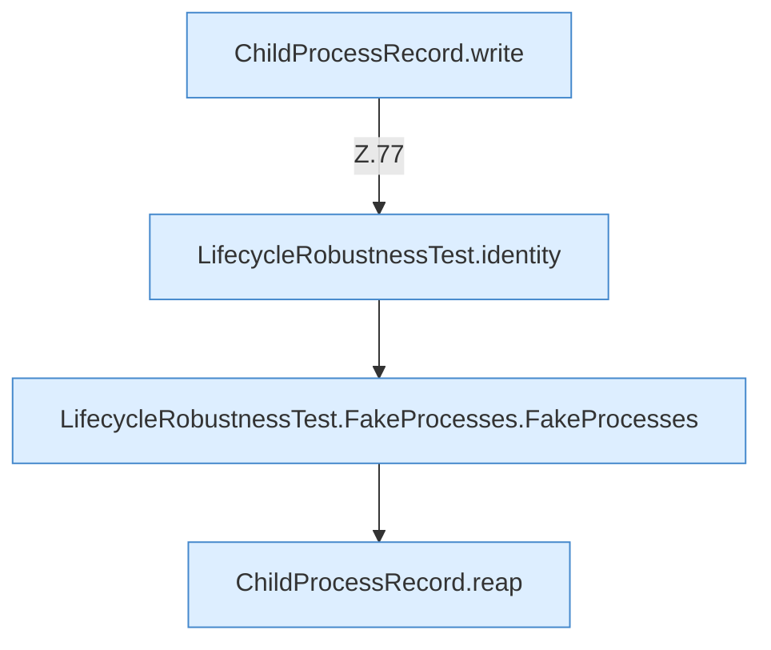

[[00 Start]] › [[Tests]] › [[LifecycleRobustnessTest]] › [[LifecycleRobustnessTest.Teil1]] › [[LifecycleRobustnessTest.reapKillsOnlyAfterGracefulStopFails]] › [[LifecycleRobustnessTest.reapKillsOnlyAfterGracefulStopFails.Teil1]]

# LifecycleRobustnessTest.reapKillsOnlyAfterGracefulStopFails.Teil1



```knoten
ChildProcessRecord.write
  Dieser Teil schreibt das. Schreibt `write`. Ruft `safe`.
LifecycleRobustnessTest.identity
  Ein Schritt in einem [[Glossar#Probelauf|Probelauf]]. Er gehört nicht zum laufenden Server. `identity` in `LifecycleRobustnessTest.java`. Nur Test.
LifecycleRobustnessTest.FakeProcesses.FakeProcesses
  Ein Schritt in einem [[Glossar#Probelauf|Probelauf]]. Er gehört nicht zum laufenden Server. `FakeProcesses` in `LifecycleRobustnessTest.java`. Nur Test.
ChildProcessRecord.reap
  Dieser Teil räumt weg das. Räumt übrige [[Glossar#Prozess|Prozesse]] ab `reap`. Ruft `read`, `ours`, `waitUntilDead`.
```

> [!knoten]- Was die Blöcke tun
> - **ChildProcessRecord.write**: Dieser Teil schreibt das. Schreibt `write`. Ruft `safe`.
> - **LifecycleRobustnessTest.identity**: Ein Schritt in einem [[Glossar#Probelauf|Probelauf]]. Er gehört nicht zum laufenden Server. `identity` in `LifecycleRobustnessTest.java`. Nur Test.
> - **LifecycleRobustnessTest.FakeProcesses.FakeProcesses**: Ein Schritt in einem [[Glossar#Probelauf|Probelauf]]. Er gehört nicht zum laufenden Server. `FakeProcesses` in `LifecycleRobustnessTest.java`. Nur Test.
> - **ChildProcessRecord.reap**: Dieser Teil räumt weg das. Räumt übrige [[Glossar#Prozess|Prozesse]] ab `reap`. Ruft `read`, `ours`, `waitUntilDead`.

- Ein weiterer Abschnitt derselben Übersicht.
- Fortsetzung von `LifecycleRobustnessTest.reapKillsOnlyAfterGracefulStopFails`.
