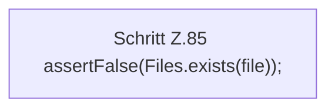

[[00 Start]] › [[Tests]] › [[LifecycleRobustnessTest]] › [[LifecycleRobustnessTest.Teil1]] › [[LifecycleRobustnessTest.reapKillsOnlyAfterGracefulStopFails]] › [[LifecycleRobustnessTest.reapKillsOnlyAfterGracefulStopFails.Teil2]]

# LifecycleRobustnessTest.reapKillsOnlyAfterGracefulStopFails.Teil2



```knoten
Schritt Z.85 assertFalse(Files.exists(file));
  Zeile 85: Dateioperation. `assertFalse(Files.exists(file));`
```

> [!knoten]- Was die Blöcke tun
> - **Schritt Z.85 assertFalse(Files.exists(file));**: Zeile 85: Dateioperation. `assertFalse(Files.exists(file));`

- Ein weiterer Abschnitt derselben Übersicht.
- Fortsetzung von `LifecycleRobustnessTest.reapKillsOnlyAfterGracefulStopFails`.
