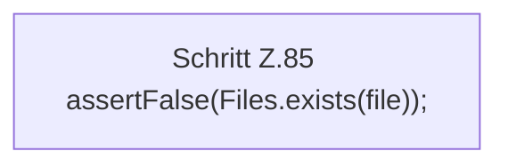

[[00 Start]] › [[Tests]] › [[LifecycleRobustnessTest]] › [[LifecycleRobustnessTest.Teil1]] › [[LifecycleRobustnessTest.reapKillsOnlyAfterGracefulStopFails]] › [[LifecycleRobustnessTest.reapKillsOnlyAfterGracefulStopFails.Teil2]]

# LifecycleRobustnessTest.reapKillsOnlyAfterGracefulStopFails.Teil2

- Fortsetzung von `LifecycleRobustnessTest.reapKillsOnlyAfterGracefulStopFails`, Quellreihenfolge.
