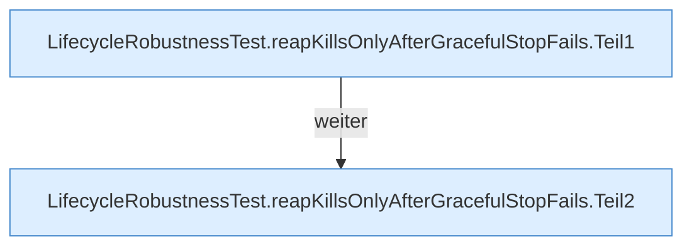

[[00 Start]] › [[Tests]] › [[LifecycleRobustnessTest]] › [[LifecycleRobustnessTest.Teil1]] › [[LifecycleRobustnessTest.reapKillsOnlyAfterGracefulStopFails]]

# LifecycleRobustnessTest.reapKillsOnlyAfterGracefulStopFails

`LifecycleRobustnessTest.reapKillsOnlyAfterGracefulStopFails()` [src/test/java/de/aichele/childlauncher/LifecycleRobustnessTest.java:74–86](https://github.com/Sciddie/minecraft-serverhoster-plugin/blob/95b02b953b0b4c23673e900e021a7c3c844aa37d/src/test/java/de/aichele/childlauncher/LifecycleRobustnessTest.java#L74-L86)

- `reapKillsOnlyAfterGracefulStopFails` in `src/test/java/de/aichele/childlauncher/LifecycleRobustnessTest.java`
- Auslöser: Test
