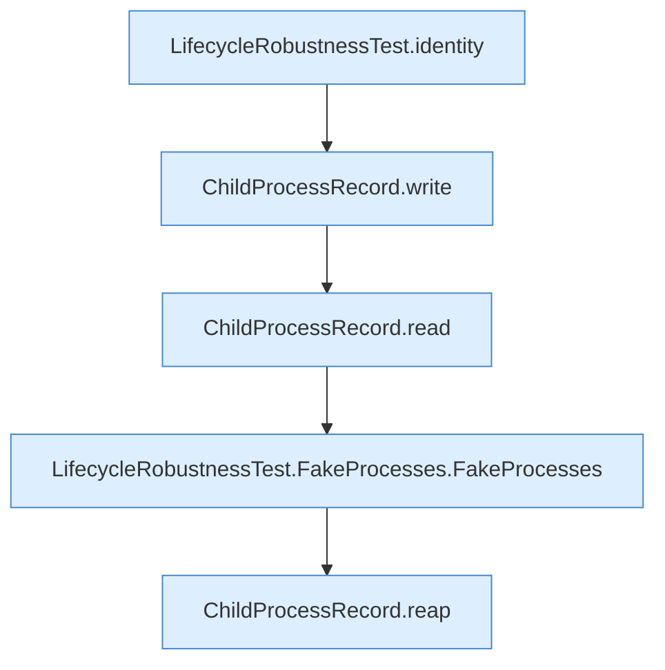

[[00 Start]] › [[Tests]] › [[LifecycleRobustnessTest]] › [[LifecycleRobustnessTest.Teil1]] › [[LifecycleRobustnessTest.reapRefusesUnmatchedProcessAndClearsOnlyADeadRecord]] › [[LifecycleRobustnessTest.reapRefusesUnmatchedProcessAndClearsOnlyADeadRecord.Teil1]]

# LifecycleRobustnessTest.reapRefusesUnmatchedProcessAndClearsOnlyADeadRecord.Teil1



```knoten
LifecycleRobustnessTest.identity
  `identity` in `LifecycleRobustnessTest.java`. Nur Test.
ChildProcessRecord.write
  Schreibt `write`. Ruft `safe`.
ChildProcessRecord.read
  Liest `read`. Ruft `required`.
LifecycleRobustnessTest.FakeProcesses.FakeProcesses
  `FakeProcesses` in `LifecycleRobustnessTest.java`. Nur Test.
ChildProcessRecord.reap
  Räumt übrige Prozesse ab `reap`. Ruft `read`, `ours`, `waitUntilDead`.
```

- Fortsetzung von `LifecycleRobustnessTest.reapRefusesUnmatchedProcessAndClearsOnlyADeadRecord`, Quellreihenfolge.
