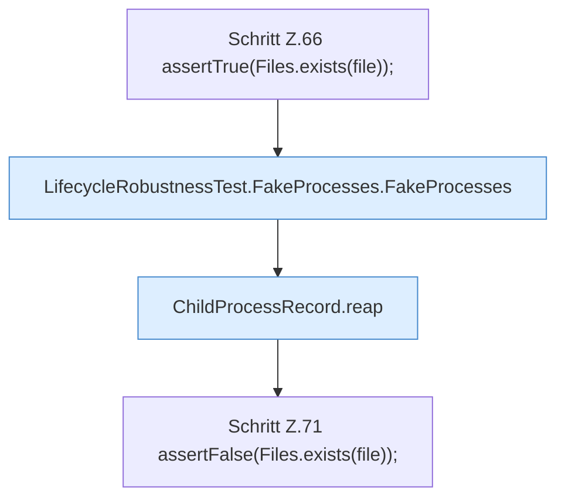

[[00 Start]] › [[Tests]] › [[LifecycleRobustnessTest]] › [[LifecycleRobustnessTest.Teil1]] › [[LifecycleRobustnessTest.reapRefusesUnmatchedProcessAndClearsOnlyADeadRecord]] › [[LifecycleRobustnessTest.reapRefusesUnmatchedProcessAndClearsOnlyADeadRecord.Teil2]]

# LifecycleRobustnessTest.reapRefusesUnmatchedProcessAndClearsOnlyADeadRecord.Teil2

- Fortsetzung von `LifecycleRobustnessTest.reapRefusesUnmatchedProcessAndClearsOnlyADeadRecord`, Quellreihenfolge.
