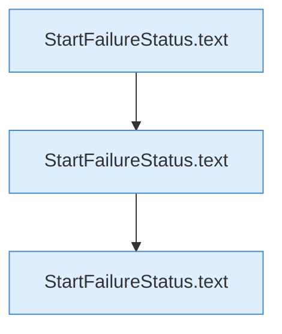

[[00 Start]] › [[Tests]] › [[LifecycleRobustnessTest]] › [[LifecycleRobustnessTest.Teil2]] › [[LifecycleRobustnessTest.retryExhaustionKeepsTheStartFailureInsteadOfPreparing]]

# LifecycleRobustnessTest.retryExhaustionKeepsTheStartFailureInsteadOfPreparing

`LifecycleRobustnessTest.retryExhaustionKeepsTheStartFailureInsteadOfPreparing()` [src/test/java/de/aichele/childlauncher/LifecycleRobustnessTest.java:233–243](https://github.com/Sciddie/minecraft-serverhoster-plugin/blob/95b02b953b0b4c23673e900e021a7c3c844aa37d/src/test/java/de/aichele/childlauncher/LifecycleRobustnessTest.java#L233-L243)



```knoten
StartFailureStatus.text
  Dieser Teil macht hier einen einzelnen Schritt. Eine Ebene tiefer steht er genauer. Antwortet mit Text `text`.
```

> [!knoten]- Was die Blöcke tun
> - **StartFailureStatus.text**: Dieser Teil macht hier einen einzelnen Schritt. Eine Ebene tiefer steht er genauer. Antwortet mit Text `text`.

- Ein Schritt in einem [[Glossar#Probelauf|Probelauf]]. Er gehört nicht zum laufenden Server.
- `retryExhaustionKeepsTheStartFailureInsteadOfPreparing` in `src/test/java/de/aichele/childlauncher/LifecycleRobustnessTest.java`
- Das ist ein Probelauf, kein Teil des laufenden Servers.
