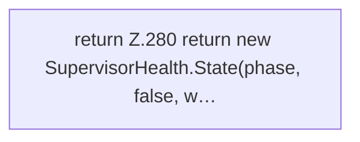

[[00 Start]] › [[Tests]] › [[LifecycleRobustnessTest]] › [[LifecycleRobustnessTest.Teil2]] › [[LifecycleRobustnessTest.state]]

# LifecycleRobustnessTest.state

`LifecycleRobustnessTest.state(SupervisorHealth.Phase phase, boolean wantRunning, boolean stopRequested, boolean processAlive, boolean watchArmed, boolean pipeArmed, boolean restartQueued, boolean launchInProgress)` [src/test/java/de/aichele/childlauncher/LifecycleRobustnessTest.java:277–282](https://github.com/Sciddie/minecraft-serverhoster-plugin/blob/95b02b953b0b4c23673e900e021a7c3c844aa37d/src/test/java/de/aichele/childlauncher/LifecycleRobustnessTest.java#L277-L282)



```knoten
return Z.280 return new SupervisorHealth.State(phase, false, w…
  Zeile 280: Rückgabe `return new SupervisorHealth.State(phase, false, w…`.
```

- `state` in `src/test/java/de/aichele/childlauncher/LifecycleRobustnessTest.java`
- Auslöser: Test
