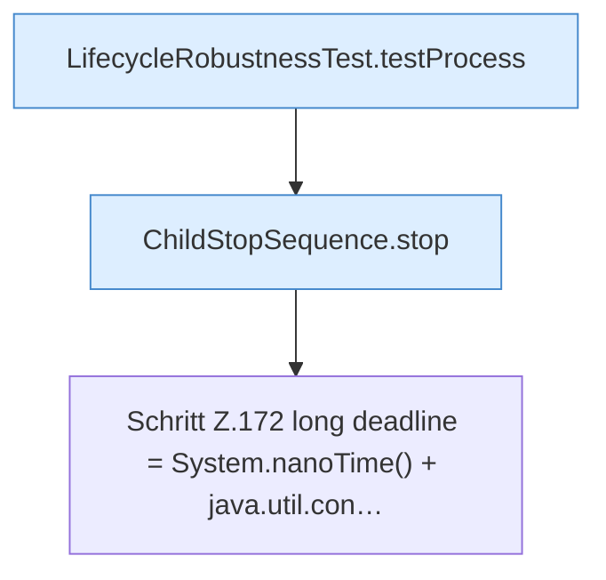

[[00 Start]] › [[Tests]] › [[LifecycleRobustnessTest]] › [[LifecycleRobustnessTest.Teil1]] › [[LifecycleRobustnessTest.stopSendsStopWhenStartupNeverBecomesReadyAndThenKills]] › [[LifecycleRobustnessTest.stopSendsStopWhenStartupNeverBecomesReadyAndThenKills.Teil1]]

# LifecycleRobustnessTest.stopSendsStopWhenStartupNeverBecomesReadyAndThenKills.Teil1



```knoten
LifecycleRobustnessTest.testProcess
  Prüft `testProcess`. Nur Test.
ChildStopSequence.stop
  Stoppt `stop`. Ruft `signal`.
Schritt Z.172 long deadline = System.nanoTime() + java.util.con…
  Zeile 172: `long deadline = System.nanoTime() + java.util.con…`
```

- Fortsetzung von `LifecycleRobustnessTest.stopSendsStopWhenStartupNeverBecomesReadyAndThenKills`, Quellreihenfolge.
