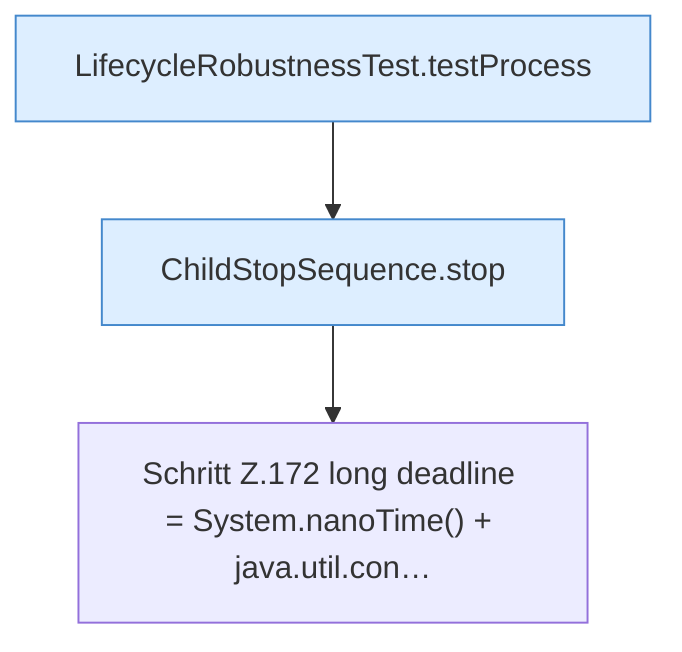

[[00 Start]] › [[Tests]] › [[LifecycleRobustnessTest]] › [[LifecycleRobustnessTest.Teil1]] › [[LifecycleRobustnessTest.stopSendsStopWhenStartupNeverBecomesReadyAndThenKills]] › [[LifecycleRobustnessTest.stopSendsStopWhenStartupNeverBecomesReadyAndThenKills.Teil1]]

# LifecycleRobustnessTest.stopSendsStopWhenStartupNeverBecomesReadyAndThenKills.Teil1



```knoten
LifecycleRobustnessTest.testProcess
  Ein Schritt in einem [[Glossar#Probelauf|Probelauf]]. Er gehört nicht zum laufenden Server. Prüft `testProcess`. Nur Test.
ChildStopSequence.stop
  Dieser Teil stoppt das. Stoppt `stop`. Ruft `signal`.
Schritt Z.172 long deadline = System.nanoTime() + java.util.con…
  Zeile 172: `long deadline = System.nanoTime() + java.util.con…`
```

> [!knoten]- Was die Blöcke tun
> - **LifecycleRobustnessTest.testProcess**: Ein Schritt in einem [[Glossar#Probelauf|Probelauf]]. Er gehört nicht zum laufenden Server. Prüft `testProcess`. Nur Test.
> - **ChildStopSequence.stop**: Dieser Teil stoppt das. Stoppt `stop`. Ruft `signal`.
> - **Schritt Z.172 long deadline = System.nanoTime() + java.util.con…**: Zeile 172: `long deadline = System.nanoTime() + java.util.con…`

- Ein weiterer Abschnitt derselben Übersicht.
- Fortsetzung von `LifecycleRobustnessTest.stopSendsStopWhenStartupNeverBecomesReadyAndThenKills`.
