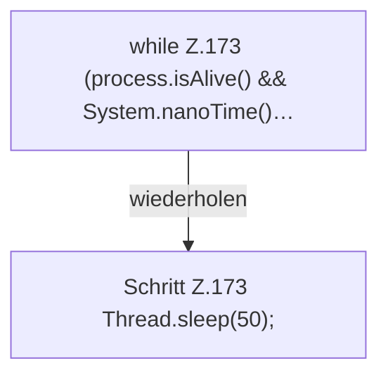

[[00 Start]] › [[Tests]] › [[LifecycleRobustnessTest]] › [[LifecycleRobustnessTest.Teil1]] › [[LifecycleRobustnessTest.stopSendsStopWhenStartupNeverBecomesReadyAndThenKills]] › [[LifecycleRobustnessTest.stopSendsStopWhenStartupNeverBecomesReadyAndThenKills.Teil2]]

# LifecycleRobustnessTest.stopSendsStopWhenStartupNeverBecomesReadyAndThenKills.Teil2



```knoten
while Z.173 (process.isAlive() && System.nanoTime()…
  Zeile 173: Schleife `(process.isAlive() && System.nanoTime()…`.
Schritt Z.173 Thread.sleep(50);
  Zeile 173: wartet. `Thread.sleep(50);`
```

- Fortsetzung von `LifecycleRobustnessTest.stopSendsStopWhenStartupNeverBecomesReadyAndThenKills`, Quellreihenfolge.
